# **Tài liệu chức năng nghiệp vụ CatPlus**
## **1. Phạm vi tài liệu**

Tài liệu này mô tả những chức năng đã có trong CatPlus theo góc nhìn nghiệp vụ: người dùng có thể làm gì và hệ thống phản hồi như thế nào.

Tài liệu không đi sâu vào cách lập trình, cấu trúc dữ liệu, giao diện kỹ thuật hoặc trình tự xử lý bên trong.

Các chức năng liên quan đến **học thử** và **tiền** đã có phần xử lý trong hệ thống nhưng hiện **chưa được đưa vào hoạt động thực tế**. Các phần này được đánh dấu rõ trong tài liệu.

## **2. Chức năng đã có**

### **2.1 Nhóm người dùng**

#### **2.1.1 Quản trị viên**

Quản trị viên có thể quản lý toàn bộ hoạt động của trung tâm:

- Tài khoản và quyền của người dùng;
- Hồ sơ học viên và gia sư;
- Lớp học, lịch học và buổi học;
- Nội dung bài tập lập trình;
- Hoạt động học tập và kết quả làm bài;
- Tiếp nhận, xếp lớp và theo dõi học viên;
- Giao bài, quản lý Problem và Problem Set;
- Các chức năng học phí, thu chi và thu nhập khi được đưa vào hoạt động.

Quản trị viên vẫn phải tuân theo các điều kiện nghiệp vụ. Ví dụ, một buổi học đã hoàn tất không thể tùy ý sửa lại như một buổi đang diễn ra.

#### **2.1.2 Nhân viên chăm sóc khách hàng**

Nhân viên chăm sóc khách hàng có thể:

> **Ghi chú: Các tính năng liên quan đến chăm sóc khách hàng hiện chưa hoàn thiện và chưa được triển khai vào hoạt động thực tế.**

- Tạo và cập nhật hồ sơ học viên;
- Tạo tài khoản học tập cho học viên;
- Theo dõi tình trạng tiếp nhận của học viên;
- Ghi chú quá trình chăm sóc;
- Xếp học viên vào lớp đang hoạt động nếu lớp còn chỗ;
- Xem thông tin của những học viên mình phụ trách;
- Xem thông tin học phí và công nợ khi nhóm chức năng này được đưa vào hoạt động.

Nhân viên chăm sóc khách hàng không được vận hành buổi học, quản lý nội dung bài lập trình hoặc thay đổi chính sách tiền lương.

#### **2.1.3 Gia sư**

Gia sư có thể:

- Xem các lớp mình phụ trách;
- Xem lịch dạy và buổi học sắp tới;
- Cập nhật đường dẫn Google Meet của lớp trong phạm vi được phép;
- Bắt đầu, điểm danh và hoàn tất buổi học;
- Ghi nhận xét cho từng học viên;
- Ghi báo cáo chung của buổi học;
- Tạo và giao bài tập từ bộ bài đã xuất bản;
- Theo dõi tiến độ và bài submit của học viên;
- Xem code của học viên trong đúng lớp và bài tập mình phụ trách;
- Lưu một bản code hỗ trợ riêng và chạy thử mà không làm thay đổi bài của học viên;
- Cập nhật hồ sơ cá nhân và gửi yêu cầu xác minh;
- Xem thu nhập của mình khi chức năng này được đưa vào hoạt động.

Gia sư không được xem toàn bộ học viên của trung tâm, tự ý chuyển lớp, quản lý tài khoản hoặc thay đổi thông tin nguồn của bài trên Polygon.

#### **2.1.4 Học viên**

Học viên có thể:

- Đăng nhập vào cổng học tập;
- Xem lớp hiện tại, gia sư và lịch học;
- Mở đường dẫn Google Meet;
- Xem bài tập được giao;
- Xem các bộ bài đã được công bố;
- Đọc đề, viết code, chạy thử và submit;
- Yêu cầu gợi ý định hướng cho code hiện tại hoặc một phiên bản submit chưa đạt khi chức năng AI được bật;
- Theo dõi kết quả chấm;
- Xem lịch sử submit và tiến độ học tập;
- Xem bảng xếp hạng khi bài có hỗ trợ;
- Xem hồ sơ, nhận xét và biểu đồ hoạt động của mình.

Học viên không được truy cập khu vực vận hành nội bộ.

### **2.2 Tài khoản và đăng nhập**

#### **2.2.1 Đăng nhập theo đúng khu vực**

Hệ thống có hai khu vực sử dụng:

- Khu vực vận hành nội bộ dành cho nhân sự trung tâm;
- Cổng học tập dành cho học viên và gia sư.

Khi đăng nhập, hệ thống kiểm tra tài khoản, mật khẩu, trạng thái tài khoản, vai trò và quyền truy cập khu vực tương ứng.

Một người có đúng vai trò nhưng chưa được cấp quyền vào khu vực đó vẫn không thể đăng nhập.

#### **2.2.2 Đổi mật khẩu**

Tài khoản mới hoặc tài khoản vừa được cấp lại mật khẩu có thể bị yêu cầu đổi mật khẩu trong lần đăng nhập đầu tiên.

Sau khi đổi thành công, người dùng tiếp tục sử dụng mật khẩu mới cho các lần đăng nhập sau.

#### **2.2.3 Đăng xuất và duy trì phiên làm việc**

Người dùng có thể đăng xuất khỏi hệ thống. Phiên làm việc được hệ thống quản lý tự động; người dùng không cần tự sao chép hoặc lưu mã đăng nhập.

Khi quyền hoặc vai trò thay đổi, người dùng có thể cần đăng xuất và đăng nhập lại để nhận quyền mới.

#### **2.2.4 Quản lý tài khoản nhân sự**

Quản trị viên có thể:

- Xem danh sách tài khoản;
- Xem chi tiết một tài khoản;
- Tạo hoặc cập nhật tài khoản nhân sự;
- Gán một hoặc nhiều vai trò;
- Cấp quyền vào khu vực vận hành hoặc cổng học tập;
- Đình chỉ tài khoản và ghi lý do.

Hệ thống không cho phép vô hiệu hóa quản trị viên đang hoạt động cuối cùng.

### **2.3 Tài khoản học viên**

#### **2.3.1 Tạo tài khoản từ hồ sơ học viên**

Tài khoản học viên được tạo từ hồ sơ đã có trong hệ thống. Mỗi tài khoản liên kết với đúng một học viên.

Học viên chỉ được cấp quyền vào cổng học tập, không được vào khu vực vận hành nội bộ.

#### **2.3.2 Tên đăng nhập**

Tên đăng nhập được tạo từ:

- Tên học viên;
- Tỉnh hoặc thành phố;
- Năm sinh;
- Số thứ tự nếu bị trùng.

Ví dụ:

```text
Nguyễn Thị Nhật Đăng, Lào Cai, 2005 → ntndangLC2005
```

Nếu tên đã tồn tại, hệ thống thêm `-2`, `-3`, ... cho đến khi không còn trùng.

Sau khi tài khoản được tạo, việc sửa tên, tỉnh hoặc năm sinh không tự động đổi tên đăng nhập.

#### **2.3.3 Mật khẩu tạm**

Khi tạo tài khoản hoặc cấp lại mật khẩu, hệ thống trả mật khẩu tạm trong lần thao tác đó.

Người phụ trách có thể sao chép thông tin gồm địa chỉ cổng học tập, tên đăng nhập và mật khẩu tạm để gửi cho đúng học viên.

#### **2.3.4 Cấp lại mật khẩu và thay đổi trạng thái**

Người có quyền có thể cấp lại mật khẩu hoặc thay đổi trạng thái tài khoản học viên.

Nếu tài khoản bị đình chỉ, học viên không thể tiếp tục đăng nhập cho đến khi tài khoản được mở lại.

### **2.4 Hồ sơ gia sư**

#### **2.4.1 Cập nhật hồ sơ**

Gia sư có thể cập nhật:

- Thông tin cá nhân;
- Địa chỉ;
- Trường học và chuyên ngành;
- Kinh nghiệm;
- Thành tích;
- Thông tin ngân hàng.

Gia sư có thể lưu hồ sơ chưa hoàn chỉnh để tiếp tục cập nhật sau.

#### **2.4.2 Gửi xác minh**

Khi hồ sơ đã đủ thông tin, gia sư có thể gửi yêu cầu xác minh.

Quản trị viên có thể:

- Xác nhận hồ sơ;
- Yêu cầu gia sư cập nhật thêm;
- Ghi chú nội dung cần sửa.

Nếu bị yêu cầu cập nhật, gia sư sửa hồ sơ rồi gửi lại. Việc chỉ bấm lưu không tự động gửi hồ sơ đi xác minh.

#### **2.4.3 Trạng thái sử dụng**

Hồ sơ chưa được xác minh hiện chưa tự động ngăn gia sư được phân công vào lớp. Trung tâm cần kiểm tra thủ công trước khi phân công.

### **2.5 Hồ sơ học viên**

#### **2.5.1 Tạo và cập nhật hồ sơ**

Hồ sơ học viên có thể chứa:

- Họ tên;
- Năm sinh;
- Tỉnh hoặc thành phố;
- Số điện thoại và thư điện tử nếu có;
- Mục tiêu học tập;
- Ghi chú;
- Thông tin người giám hộ.

Thông tin người giám hộ không bắt buộc. Học viên tự liên hệ vẫn có thể được tiếp nhận.

#### **2.5.2 Tìm kiếm và xem chi tiết**

Người có quyền có thể tìm học viên theo tên, mã, số điện thoại hoặc thư điện tử.

Trang chi tiết hiển thị thông tin cá nhân, lớp hiện tại, tình trạng tiếp nhận và các dữ liệu liên quan trong phạm vi quyền của người xem.

#### **2.5.3 Đóng và mở lại hồ sơ**

Học viên không tiếp tục tham gia có thể được đánh dấu là đã đóng, kèm lý do và ghi chú.

Hồ sơ đã đóng không thể được xếp vào lớp mới cho đến khi được mở lại.

### **2.6 Theo dõi tình trạng tiếp nhận học viên**

Hệ thống theo dõi học viên theo các tình trạng:

- Chưa liên hệ;
- Chờ kiểm tra đầu vào;
- Chờ học thử;
- Chờ lớp;
- Đã tham gia.

Nhân viên chăm sóc khách hàng có thể cập nhật tình trạng và ghi chú theo diễn biến thực tế.

Mỗi học viên có một người phụ trách hiện tại. Khi đổi người phụ trách, hệ thống vẫn giữ lịch sử phân công cũ.

### **2.7 Quản lý lớp học**

#### **2.7.1 Tạo và cập nhật lớp**

Lớp học có các thông tin chính:

- Mã lớp;
- Tên lớp;
- Nội dung hoặc chương trình học;
- Cấp học;
- Loại lớp;
- Số học viên tối đa;
- Gia sư phụ trách;
- Thời gian dự kiến;
- Đường dẫn Google Meet.

Lớp một kèm một chỉ có một học viên. Lớp nhóm hiện cho phép sức chứa từ ba đến năm học viên.

#### **2.7.2 Trạng thái lớp**

Lớp có thể ở một trong các trạng thái:

- Bản nháp;
- Đang hoạt động;
- Tạm dừng;
- Đã hoàn thành.

Chỉ lớp đang hoạt động mới nhận học viên mới và vận hành lịch học bình thường.

Ngày kết thúc dự kiến không tự động hoàn thành lớp. Người có quyền phải chủ động chuyển trạng thái.

#### **2.7.3 Phân công gia sư**

Mỗi lớp có thể được gắn với một gia sư phụ trách. Gia sư chỉ nhìn thấy và thao tác trên những lớp thuộc phạm vi của mình.

Việc thay đổi gia sư phải tuân theo quyền và kiểm tra xung đột lịch.

#### **2.7.4 Google Meet**

Người có quyền có thể lưu đường dẫn Google Meet cho lớp.

Gia sư và học viên có thể mở hoặc sao chép đường dẫn. CatPlus không quản lý quyền tham gia phòng họp; quyền này do Google Meet quyết định.

### **2.8 Xếp học viên vào lớp**

#### **2.8.1 Xếp một học viên**

Một học viên có thể được xếp vào lớp khi:

- Hồ sơ không bị đóng;
- Lớp đang hoạt động;
- Lớp còn chỗ;
- Học viên chưa tham gia một lớp hiện hành khác.

Sau khi xếp thành công, học viên được tính là đang tham gia lớp ngay tại thời điểm xếp.

Nếu thao tác được gửi lại cho cùng học viên và cùng lớp, hệ thống trả kết quả hiện có thay vì tạo bản ghi trùng.

#### **2.8.2 Xếp nhiều học viên**

Người dùng có thể chọn nhiều học viên để thêm vào lớp cùng lúc.

Hệ thống kiểm tra toàn bộ danh sách trước khi thêm. Nếu có học viên không hợp lệ hoặc số lượng vượt quá chỗ còn lại, toàn bộ thao tác bị từ chối để tránh lớp ở trạng thái dở dang.

#### **2.8.3 Một lớp hiện hành**

Mỗi học viên chỉ có một quan hệ lớp hiện hành tại một thời điểm.

Lịch sử tham gia lớp cũ vẫn được giữ lại để phục vụ việc xem buổi học, nhận xét và các dữ liệu trước đây.

### **2.9 Chuyển lớp**

Khi chuyển lớp, hệ thống kết thúc quan hệ của học viên với lớp cũ và tạo quan hệ mới với lớp đích tại cùng một thời điểm.

Lớp đích phải đang hoạt động và còn chỗ.

Sau khi chuyển:

- Các buổi trước thời điểm chuyển vẫn thuộc lịch sử lớp cũ;
- Các buổi sau thời điểm chuyển được tính theo lớp mới;
- Dữ liệu của những buổi đã hoàn tất không bị thay đổi.

Hệ thống không xóa lịch sử lớp cũ khi chuyển lớp.

### **2.10 Lịch học**

#### **2.10.1 Lịch học định kỳ**

Mỗi lớp có thể được cấu hình lịch theo:

- Thứ trong tuần;
- Giờ bắt đầu;
- Thời lượng;
- Thời gian bắt đầu áp dụng;
- Thời gian kết thúc áp dụng nếu có.

Hệ thống hiển thị trước các buổi dự kiến để người dùng kiểm tra trước khi tạo lịch chính thức.

#### **2.10.2 Tạo buổi học**

Các buổi học tương lai được tạo từ lịch định kỳ của lớp.

Hệ thống kiểm tra để không tạo trùng buổi khi cùng một lịch được xử lý nhiều lần.

#### **2.10.3 Kiểm tra xung đột**

Hệ thống ngăn các trường hợp:

- Hai lịch của cùng lớp chồng lên nhau;
- Gia sư bị xếp vào hai buổi trùng giờ trong phạm vi kiểm tra;
- Thời gian bắt đầu, thời lượng hoặc khoảng áp dụng không hợp lệ.

#### **2.10.4 Dời lịch**

Buổi học tương lai có thể được dời nếu chưa phát sinh điểm danh, nhận xét, bài tập hoặc dữ liệu hoàn tất.

Buổi cũ vẫn được giữ lại để thể hiện rằng nó đã được dời sang một buổi khác.

#### **2.10.5 Hủy và dạy bù**

Người có quyền có thể hủy buổi và ghi lý do.

Một buổi bù có thể được tạo từ buổi đã hủy. Buổi bù là một buổi riêng nhưng vẫn giữ liên kết với buổi gốc.

### **2.11 Vận hành buổi học**

#### **2.11.1 Trạng thái buổi học**

Buổi học có các trạng thái chính:

- Đã lên lịch;
- Đang diễn ra;
- Đã hoàn tất;
- Đã hủy;
- Đã dời lịch.

#### **2.11.2 Bắt đầu buổi học**

Gia sư hoặc người có quyền có thể bắt đầu buổi thuộc phạm vi của mình.

Khi bắt đầu, buổi chuyển sang trạng thái đang diễn ra và ghi nhận gia sư thực tế.

#### **2.11.3 Điểm danh**

Danh sách điểm danh được lấy từ những học viên thuộc lớp tại thời điểm buổi học diễn ra.

Gia sư có thể ghi trạng thái tham gia và ghi chú cho từng học viên.

Tất cả học viên trong danh sách phải được điểm danh trước khi buổi học được hoàn tất.

#### **2.11.4 Hoàn tất buổi học**

Khi hoàn tất, hệ thống giữ lại bản chụp danh sách học viên, thông tin lớp, gia sư thực tế và thời điểm hoàn tất.

Sau đó, các thông tin lịch sử quan trọng của buổi được khóa. Không có chức năng hoàn tác trực tiếp một buổi đã hoàn tất.

#### **2.11.5 Buổi bị hủy hoặc dời**

Buổi bị hủy không được xem là một buổi đã dạy.

Buổi dạy bù đã diễn ra và hoàn tất được xem là một buổi thực tế riêng.

### **2.12 Nhận xét và báo cáo buổi học**

#### **2.12.1 Nhận xét từng học viên**

Gia sư có thể ghi một nhận xét cho từng học viên trong buổi học.

Nhận xét chỉ được tạo cho học viên thuộc đúng danh sách của buổi và có trạng thái điểm danh phù hợp.

Khi nhận xét được sửa, hệ thống giữ lại các phiên bản trước để có thể kiểm tra lịch sử.

Sau khi buổi đã hoàn tất, gia sư không thể sửa nhận xét. Quản trị viên chỉ có thể hiệu chỉnh nhận xét đã có và phải ghi lý do.

#### **2.12.2 Báo cáo chung**

Báo cáo chung có thể gồm:

- Giai đoạn học;
- Cuộc thi hoặc chương trình liên quan;
- Nội dung đã học;
- Ghi chú chung.

Báo cáo được chỉnh sửa khi buổi đang diễn ra. Sau khi buổi hoàn tất, báo cáo chuyển sang chỉ đọc.

#### **2.12.3 Gửi nhận xét ra bên ngoài**

Hệ thống hiện chưa tự động gửi nhận xét qua Zalo, thư điện tử hoặc ứng dụng nhắn tin khác.

### **2.13 Học thử**

> **Ghi chú: Nhóm chức năng học thử chưa được đưa vào hoạt động thực tế.**

Hệ thống đã có khả năng quản lý hai dạng học thử:

- Buổi học thử riêng;
- Học viên học thử trong một buổi của lớp đang hoạt động.

Một buổi học thử có thể lưu:

- Thời gian;
- Gia sư;
- Hình thức học;
- Đường dẫn hoặc phòng học;
- Danh sách người tham gia;
- Các Problem Set được sử dụng;
- Ghi chú và trạng thái.

Gia sư có thể xem nội dung, theo dõi bài submit, điểm danh và hoàn tất buổi học thử trong phạm vi được giao.

Nếu buổi lớp liên quan bị hủy hoặc dời, thông tin học thử được điều chỉnh để không bị tách khỏi buổi gốc.

### **2.14 Quản lý bài từ Polygon**

#### **2.14.1 Đồng bộ Problem**

Người có quyền có thể yêu cầu đồng bộ Problem từ Polygon.

Hệ thống nhận các nội dung do Polygon cung cấp, gồm statement, test, package, checker và giới hạn chạy bài.

Nếu dữ liệu chưa đầy đủ hoặc chưa đạt điều kiện, Problem chưa được coi là sẵn sàng để sử dụng.

#### **2.14.2 Xem tình trạng đồng bộ**

Người dùng có thể xem:

- Problem đang được đồng bộ hay đã hoàn tất;
- Lần đồng bộ gần đây;
- Kết quả kiểm tra package;
- Lỗi đồng bộ nếu có.

#### **2.14.3 Thông tin phục vụ giảng dạy**

Sau khi Problem được đồng bộ, Quản trị viên có thể bổ sung thông tin phục vụ giảng dạy như chủ đề, độ khó và ghi chú.

Các thông tin này thuộc CatPlus và không làm thay đổi nội dung nguồn trên Polygon.

### **2.15 Chủ đề bài tập**

Người có quyền có thể:

- Tạo chủ đề;
- Đổi tên hoặc cập nhật chủ đề;
- Sắp xếp thứ tự;
- Lưu trữ chủ đề không còn sử dụng;
- Gắn một hoặc nhiều chủ đề vào Problem.

Chủ đề giúp tìm kiếm và tổ chức các Problem theo nội dung học tập.

### **2.16 Bộ bài tập**

#### **2.16.1 Tạo và chỉnh sửa Problem Set**

Người có quyền có thể tạo Problem Set từ các Problem đã có trong CatPlus.

Problem Set có thể chứa:

- Tên;
- Mô tả;
- Danh sách Problem;
- Thứ tự các Problem;
- Ghi chú cho từng Problem;
- Trạng thái sử dụng.

#### **2.16.2 Xuất bản**

Problem Set chỉ được xuất bản khi đáp ứng điều kiện sử dụng.

Sau khi xuất bản, Problem Set có thể xuất hiện trong cổng học tập hoặc được gia sư chọn để giao bài.

#### **2.16.3 Lưu trữ**

Problem Set không còn sử dụng có thể được lưu trữ thay vì xóa hoàn toàn.

Việc lưu trữ không làm mất các bài tập đã giao trước đó.

#### **2.16.4 Nhóm nhiều Problem Set**

Hệ thống có thể nhóm nhiều Problem Set thành một nhóm nội dung lớn hơn, đồng thời cho phép sắp xếp thứ tự và lưu trữ nhóm.

### **2.17 Giao bài tập**

#### **2.17.1 Tạo bài tập từ buổi học**

Gia sư có thể chọn một Problem Set đã xuất bản để giao cho lớp.

Bài tập được giao có thể gồm:

- Tiêu đề;
- Hướng dẫn;
- Problem Set;
- Hạn hoàn thành;
- Trạng thái bản nháp hoặc đã công bố.

#### **2.17.2 Bản nháp và công bố**

Gia sư có thể lưu bài tập dưới dạng bản nháp để tiếp tục chỉnh sửa hoặc công bố ngay.

Chỉ bài tập đã công bố mới xuất hiện với học viên.

#### **2.17.3 Giữ nội dung tại thời điểm giao**

Khi bài tập được tạo, hệ thống giữ lại tên Problem Set và danh sách Problem tại thời điểm đó.

Việc chỉnh sửa Problem Set về sau không tự động thêm hoặc xóa Problem trong bài tập cũ.

Phiên bản statement và test cụ thể của từng Problem chưa được cố định riêng tại thời điểm giao.

#### **2.17.4 Điều kiện học viên nhìn thấy bài**

Học viên chỉ nhìn thấy bài tập khi:

- Bài đã được công bố;
- Bài thuộc lớp học viên đang tham gia;
- Tài khoản học tập liên kết đúng hồ sơ học viên.

### **2.18 Cổng học tập của học viên**

#### **2.18.1 Trang chính**

Trang chính hiển thị:

- Tên và mục tiêu học tập;
- Lớp hiện tại;
- Gia sư;
- Buổi học tiếp theo;
- Đường dẫn Google Meet;
- Bài được giao;
- Các lần submit gần đây.

#### **2.18.2 Thông tin lớp**

Học viên có thể xem lịch cố định, gia sư, buổi sắp tới và bài tập của lớp.

Dữ liệu lớp được giới hạn theo thời gian học viên thực sự tham gia lớp.

#### **2.18.3 Thư viện Problem Set**

Học viên có thể xem các Problem Set đã được công bố, mở từng Problem và đọc statement.

#### **2.18.4 Không gian viết code**

Khi mở một Problem, học viên có thể:

- Đọc statement;
- Chọn ngôn ngữ được hỗ trợ;
- Dùng code mẫu nếu có;
- Viết code;
- Chạy thử;
- Submit;
- Yêu cầu gợi ý định hướng cho code hiện tại;
- Theo dõi kết quả;
- Xem các lần submit trước;
- Mở một phiên bản chưa đạt và yêu cầu gợi ý đúng theo kết quả chấm của phiên bản đó khi chức năng AI được bật.

#### **2.18.5 Tiến độ bài được giao**

Tiến độ có thể được hiển thị là:

- Chưa bắt đầu;
- Đang thực hiện;
- Đã hoàn thành;
- Quá hạn.

Bài được xem là hoàn thành khi học viên đã giải đúng toàn bộ Problem thuộc bài tập.

Nếu không lấy được dữ liệu chấm bài, hệ thống báo không thể tải tiến độ thay vì tự đoán.

#### **2.18.6 Hồ sơ và biểu đồ hoạt động**

Học viên có thể xem hồ sơ, mục tiêu và biểu đồ số lần submit theo ngày trong mười hai tháng.

Biểu đồ này phản ánh hoạt động làm bài, không phải điểm danh hoặc thời lượng học.

### **2.19 Chạy thử code**

Chạy thử giúp học viên kiểm tra nhanh code trước khi submit chính thức.

Kết quả có thể hiển thị:

- Code có biên dịch được hay không;
- Kết quả in ra;
- Lỗi khi chạy;
- Thời gian và bộ nhớ;
- Kết quả so sánh khi có đáp án mẫu.

Chạy thử không được tính là một bài submit chính thức, không cập nhật tiến độ hoàn thành và không mở quyền xem lời giải của học viên khác.

### **2.20 Submit và chấm bài**

#### **2.20.1 Submit bài**

Khi học viên submit, hệ thống ghi nhận code, Problem, ngôn ngữ và người submit.

Bài được đưa vào hàng chờ chấm. Trong thời gian chờ, học viên có thể thấy trạng thái đang xử lý.

#### **2.20.2 Kết quả chấm**

Sau khi chấm, hệ thống hiển thị kết quả bằng tiếng Việt, chẳng hạn:

- Đúng;
- Sai đáp án;
- Quá thời gian;
- Vượt giới hạn bộ nhớ;
- Lỗi khi chạy;
- Lỗi biên dịch;
- Lỗi hệ thống.

Kết quả có thể đi kèm điểm, thời gian chạy và bộ nhớ sử dụng.

#### **2.20.3 Lịch sử submit**

Học viên có thể xem các bài mình đã submit, lọc theo kết quả và mở chi tiết từng lần.

Học viên không thể xem bài submit của người khác bằng cách thay đổi địa chỉ trang hoặc mã bài submit.

#### **2.20.4 Hỗ trợ tìm lỗi khi sai đáp án**

Khi bài sai đáp án, hệ thống có thể hiển thị một số test sai để học viên tìm lỗi.

Chỉ một phần nhỏ test được phép hiển thị. Các test ẩn còn lại không được gửi về trình duyệt.

#### **2.20.5 Bảng xếp hạng**

Bảng xếp hạng có thể hiển thị thứ hạng, điểm và thông tin kết quả của từng học viên.

Bảng xếp hạng không tự động công khai code.

#### **2.20.6 Xem lời giải của học viên khác**

Học viên chỉ được xem code đúng của học viên khác khi chính mình đã có ít nhất một bài submit đúng cho cùng Problem.

Chỉ code của bài submit đúng được hiển thị. Code của bài sai, bản nháp hoặc lần chạy thử không được công khai.

### **2.21 Không gian giảng dạy của gia sư**

#### **2.21.1 Tổng quan công việc**

Gia sư có thể xem:

- Buổi đang diễn ra;
- Buổi sắp tới;
- Các việc cần hoàn tất;
- Các lớp đang phụ trách;
- Lịch dạy theo tuần;
- Lịch sử buổi học.

#### **2.21.2 Theo dõi Problem Set**

Gia sư có thể mở một Problem Set theo lớp hoặc theo bài tập đã giao để xem:

- Danh sách Problem;
- Bài submit mới nhất;
- Tiến độ từng học viên;
- Điểm tốt nhất;
- Số lần submit;
- Bảng xếp hạng.

Khi xem theo một bài tập cụ thể, hệ thống chỉ tính hoạt động thuộc lần giao bài đó.

#### **2.21.3 Xem code và hỗ trợ học viên**

Gia sư có thể mở bài submit thuộc lớp mình phụ trách để xem code và kết quả chấm.

Gia sư có thể lưu một bản code hỗ trợ riêng và chạy thử bản đó. Bản hỗ trợ không thay đổi code, kết quả hoặc lịch sử của học viên.

Gia sư không thể submit thay học viên bằng chức năng này.

### **2.22 Học phí**

> **Ghi chú: Nhóm chức năng học phí và tính tiền chưa được đưa vào hoạt động thực tế.**

Hệ thống đã có khả năng:

- Tạo các gói học phí;
- Tạo nhiều mức giá cho một gói;
- Gắn thỏa thuận học phí với học viên và lớp;
- Phát hành kỳ học phí;
- Giữ lại mức giá áp dụng tại thời điểm phát hành;
- Theo dõi số tiền phải thu và số buổi liên quan.

Khi mức giá thay đổi, kỳ đã phát hành vẫn giữ mức giá cũ. Mức giá mới chỉ áp dụng cho kỳ phù hợp tiếp theo.

Học phí hiện chưa được hiển thị trên cổng học tập của học viên.

### **2.23 Thanh toán**

> **Ghi chú: Nhóm chức năng thanh toán chưa được đưa vào hoạt động thực tế.**

Hệ thống đã có khả năng ghi nhận khoản tiền thực thu theo các hình thức:

- Chuyển khoản;
- Tiền mặt;
- Hình thức khác.

Mỗi khoản thanh toán có thể lưu số tiền, thời điểm, mã tham chiếu và ghi chú.

Nếu cùng một yêu cầu được gửi lại, hệ thống tránh tạo khoản thanh toán trùng.

Khoản ghi sai được đánh dấu hủy và lưu lý do thay vì bị xóa khỏi lịch sử.

Hệ thống chưa kết nối cổng thanh toán hoặc tự động đọc giao dịch ngân hàng.

### **2.24 Công nợ**

> **Ghi chú: Nhóm chức năng công nợ chưa được đưa vào hoạt động thực tế.**

Công nợ được tính từ số tiền phải thu trừ đi các khoản thanh toán hợp lệ.

Hệ thống có thể:

- Hiển thị số đã thu;
- Hiển thị số còn thiếu;
- Xác định khoản quá hạn dựa trên ngày đến hạn;
- Lọc các học viên còn công nợ;
- Giới hạn dữ liệu theo phạm vi của nhân viên chăm sóc khách hàng.

Kỳ học phí còn là bản nháp không được tính là khoản phải thu.

### **2.25 Sổ thu chi**

> **Ghi chú: Nhóm chức năng sổ thu chi chưa được đưa vào hoạt động thực tế.**

Hệ thống đã có khả năng:

- Quản lý tài khoản tiền;
- Quản lý nhóm thu và chi;
- Ghi nhận giao dịch thủ công;
- Tạo khoản thu từ thanh toán học phí;
- Tạo khoản chi từ thanh toán lương;
- Xem tổng hợp thu chi;
- Đảo một giao dịch ghi sai.

Giao dịch sai được xử lý bằng một bản ghi đảo để giữ lịch sử, không bị xóa trực tiếp.

### **2.26 Thu nhập gia sư**

> **Ghi chú: Nhóm chức năng tính thu nhập gia sư chưa được đưa vào hoạt động thực tế.**

Hệ thống đã có khả năng tạo khoản thu nhập khi một buổi học được hoàn tất.

Mức tiền được xác định theo số học viên trong danh sách đã chốt của buổi học, không dựa trên số học viên thực tế có mặt.

Theo cấu hình hiện có:

| Số học viên | Mức tiền mỗi buổi |
|---:|---:|
| 1, lớp một kèm một | 200.000 đồng |
| 2 | 150.000 đồng |
| 3 | 180.000 đồng |
| 4 | 210.000 đồng |
| 5 | 250.000 đồng |

Buổi bị hủy không được tính. Buổi dạy bù đã hoàn tất được tính như một buổi thực tế.

Nếu thiếu thông tin cần thiết, hệ thống tạo một mục cần kiểm tra thay vì tự đoán số tiền.

### **2.27 Hoa hồng chăm sóc khách hàng**

> **Ghi chú: Nhóm chức năng tính hoa hồng chưa được đưa vào hoạt động thực tế.**

Hệ thống đã có khả năng tính hoa hồng bằng 8% số tiền thực thu của từng khoản thanh toán hợp lệ.

Người hưởng là nhân viên chăm sóc khách hàng đã được ghi nhận cho kỳ học phí tại thời điểm kỳ được tạo. Việc đổi người phụ trách hiện tại không tự chuyển hoa hồng của kỳ cũ sang người mới.

Nếu thiếu người hưởng, chính sách hoặc kỳ lương, hệ thống tạo một mục cần kiểm tra thay vì tự động gán.

### **2.28 Bảng lương và đối soát**

> **Ghi chú: Nhóm chức năng bảng lương và thanh toán lương chưa được đưa vào hoạt động thực tế.**

Hệ thống đã có khả năng:

- Mở kỳ lương theo tháng;
- Tập hợp thu nhập gia sư và hoa hồng chăm sóc khách hàng;
- Ghi khoản điều chỉnh;
- Ghi các trường hợp cần kiểm tra;
- Tính bảng đối soát cho từng thành viên;
- Chốt kỳ lương;
- Ghi nhận thanh toán lương;
- Đảo khoản thanh toán lương bị ghi sai.

Hệ thống không tự động tính hoặc chốt kỳ vào cuối tháng. Người có quyền phải chủ động thực hiện.

Kỳ lương không được chốt khi vẫn còn trường hợp cần kiểm tra.

### **2.29 Thông tin tổng hợp**

Hệ thống cung cấp các màn hình tổng hợp phù hợp với từng vai trò, chẳng hạn:

- Số lượng học viên và lớp;
- Buổi học sắp tới hoặc cần xử lý;
- Tình trạng lớp và lịch học;
- Tiến độ làm bài và lịch sử submit;
- Số liệu học phí, công nợ, thu chi và thu nhập khi các nhóm này được đưa vào hoạt động.

Phần báo cáo tổng hợp chuyên biệt vẫn chưa được hoàn thiện thành một khu vực báo cáo riêng.

## **3. Chức năng mới đã triển khai: Hỗ trợ định hướng làm bài với AI**

### **3.1 Mục tiêu**

Chức năng hỗ trợ học viên tìm ra hướng làm tiếp theo hoặc tự nhận biết lỗi trong code mà không cung cấp lời giải hoàn chỉnh.

Trong khu vực viết code có thêm nút:

```text
Gợi ý với AI
```

Khi học viên sử dụng, AI đọc code hiện tại và những thông tin liên quan đến bài làm, sau đó đặt bình luận tại các dòng phù hợp trong trình soạn thảo.

Chức năng chỉ đóng vai trò định hướng. Kết quả đúng hay sai vẫn được xác nhận bằng lần submit chính thức.

> **Trạng thái hiện tại:** Phần triển khai của CatPlus, giao diện học viên, giới hạn sử dụng, thông báo đồng ý và các trường hợp phân tích đã hoàn thành. Kiểm chứng đầu cuối bằng phản hồi Gemini thật đã hoàn thành thành công cho code hiện tại, phiên bản WA và các trường hợp CE, TLE, MLE, RTE, OLE trên bài toán Dijkstra. Kết nối mạng đi ra ngoài (outbound network) và chuỗi cấu hình thời gian chờ (timeout hierarchy) cho dịch vụ OJ đã được cấu hình phục vụ vận hành thử nghiệm có kiểm soát.

### **3.2 Dịch vụ AI được sử dụng**

CatPlus gọi **Gemini API** để triển khai chức năng. Mô hình được sử dụng là:

```text
Mô hình: gemini-3.8-flash
Mức suy luận: high
```

Tên gọi trong tài liệu nghiệp vụ là **Gemini 3.8 Flash High**. Về cấu hình gọi API, `gemini-3.8-flash` là mã mô hình và `high` là mức suy luận.

CatPlus không tự xây dựng hoặc huấn luyện một mô hình AI riêng. Hệ thống chỉ chuẩn bị dữ liệu được phép sử dụng, gửi yêu cầu tới Gemini API và nhận lại các bình luận gợi ý.

Học viên không gọi trực tiếp Gemini API và không nhìn thấy khóa truy cập. Mọi yêu cầu đều đi qua CatPlus để hệ thống kiểm tra quyền, giới hạn sử dụng và nội dung được phép gửi.

Thông tin chính thức về mô hình được tham chiếu tại [Gemini 3.8 Flash](https://ai.google.dev/gemini-api/docs/models/gemini-3.8-flash).

#### **3.2.1 Lý do lựa chọn Gemini 3.8 Flash High**

Đối tượng học viên chính của trung tâm là học sinh trung học cơ sở. Dựa trên kinh nghiệm sử dụng thực tế, Gemini có khả năng hiểu, phân tích và giải tốt các bài tập lập trình ở mức độ phù hợp với nhóm học viên này.

Trong phạm vi các bài đã được trung tâm thử nghiệm, chưa ghi nhận trường hợp mô hình giải sai đối với những bài không vượt quá mức độ học sinh giỏi cấp tỉnh, kể cả các bài dành cho học sinh trung học phổ thông. Một số ít trường hợp giải sai được ghi nhận khi bài tập đạt mức độ đội tuyển quốc gia trở lên. Tuy nhiên, với những trường hợp này, mô hình vẫn có thể đưa ra lời giải chính xác sau một vài lần điều chỉnh và gửi lại nội dung yêu cầu.

Kết quả trên cho thấy mô hình đáp ứng được yêu cầu chuyên môn để hỗ trợ học viên tìm hướng làm bài và nhận biết lỗi trong code. Tuy nhiên, đây là kết quả ghi nhận trong phạm vi thử nghiệm thực tế, không được xem là cam kết rằng mọi phản hồi của AI đều chính xác trong tất cả trường hợp. Học viên vẫn cần tự kiểm tra và submit để xác nhận kết quả.

Một lý do quan trọng khác là chi phí sử dụng Gemini thấp hơn đáng kể so với các mô hình AI khác đã được xem xét. Mức chi phí này phù hợp với nhu cầu sử dụng thường xuyên tại trung tâm, giúp triển khai chức năng cho nhiều học viên mà vẫn kiểm soát được chi phí vận hành.

### **3.3 Cách chức năng hoạt động**

Nút **Gợi ý với AI** được sử dụng theo hai trường hợp riêng biệt:

1. Học viên nhấn nút tại trình soạn thảo chính để nhận gợi ý cho code đang viết.
2. Học viên mở **Lịch sử làm bài**, chọn một phiên bản submit bị lỗi rồi nhấn nút để AI phân tích đúng phiên bản đó.

Hệ thống xác định nội dung cần phân tích dựa trên vị trí học viên sử dụng nút. Hệ thống không tự lấy kết quả submit gần nhất để phân tích khi học viên đang yêu cầu gợi ý cho code hiện tại.

Mỗi lần sử dụng chỉ có một mục đích phân tích. AI phải giữ đúng phạm vi của trường hợp đang được yêu cầu và không bổ sung nhận xét thuộc trường hợp khác.

Tóm tắt cách xử lý các trường hợp:

- **Code hiện tại:** AI chỉ đưa ra định hướng nên làm gì tiếp theo dựa trên code đang có trong trình soạn thảo, không yêu cầu học viên phải submit trước và không cảnh báo thêm những lỗi có thể xảy ra.
- **WA:** AI đưa ra hướng giúp học viên tự tìm lỗi, không chỉ thẳng lời giải hoặc tiết lộ test ẩn.
- **TLE:** AI chỉ ra phần code có nguy cơ chạy quá lâu và gợi ý hướng giảm số lần xử lý.
- **MLE:** AI chỉ ra phần code có nguy cơ sử dụng quá nhiều bộ nhớ và gợi ý hướng giảm bộ nhớ.
- **RTE:** AI đánh dấu vị trí có khả năng làm chương trình dừng bất thường và giải thích nguyên nhân có thể xảy ra.
- **CE:** AI sử dụng thông báo biên dịch để đánh dấu và giải thích lỗi tại dòng code liên quan.
- **Lỗi khác:** AI phân tích theo thông tin chấm bài được phép hiển thị và chỉ kết luận khi có đủ căn cứ.
- **Đang chờ chấm:** Chưa phân tích lỗi cho đến khi có kết quả hoàn chỉnh.
- **AC:** Không thực hiện phân tích lỗi; việc giải thích hoặc tối ưu code đã đúng thuộc một chức năng khác.

Sau khi nhận kết quả từ Gemini API, hệ thống hiển thị gợi ý dưới dạng bình luận tại những dòng code phù hợp.

Bình luận AI được hiển thị như ghi chú gắn với dòng code, không tự thay đổi nội dung code thật. Học viên có thể ẩn hoặc xóa các bình luận này.

Mỗi bình luận có nhãn **Gợi ý từ AI** để phân biệt với code và bình luận do học viên tự viết.

### **3.4 Các trường hợp chính**

#### **3.4.1 Gợi ý cho code hiện tại trong trình soạn thảo**

Đây là cách hoạt động mặc định khi học viên nhấn nút **Gợi ý với AI** tại trình soạn thảo chính.

Trường hợp này áp dụng khi học viên đang viết bài, bao gồm:

- Chưa từng submit;
- Đã từng submit nhưng đang sửa hoặc viết tiếp code;
- Code đang viết dở hoặc chưa thể chạy hoàn chỉnh.

AI chỉ đọc code đang có trong trình soạn thảo tại thời điểm nhấn nút và đối chiếu với statement để đưa ra định hướng tiếp theo. Hệ thống không gửi kèm kết quả lỗi của các phiên bản submit trước.

Học viên không bắt buộc phải submit và cũng không cần có kết quả chấm trước khi nhận gợi ý. Nếu học viên đã từng submit nhưng sau đó tiếp tục sửa code, AI vẫn phân tích code hiện tại, không tự dùng lỗi của một phiên bản cũ để kết luận về phiên bản đang viết.

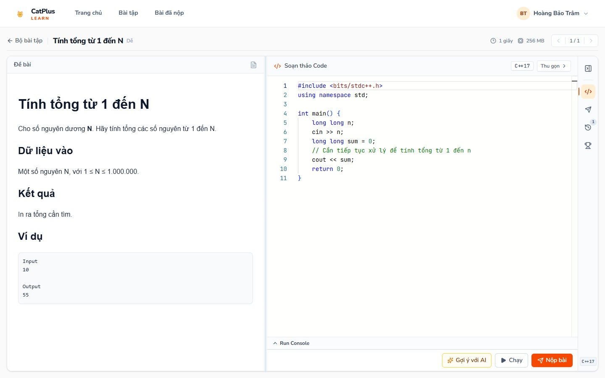

*Hình 3.1. Học viên mở trình soạn thảo, viết code và sử dụng nút Gợi ý với AI mà không bắt buộc phải submit trước.*

Nội dung gợi ý có thể gồm:

- Phần yêu cầu trong statement mà code chưa xử lý;
- Bước xử lý tiếp theo cần bổ sung;
- Biến, dữ liệu hoặc cách tổ chức dữ liệu cần chuẩn bị cho bước tiếp theo;
- Câu hỏi giúp học viên tự chọn cách giải;
- Phần code đang viết dở cần tiếp tục hoàn thiện.

Các gợi ý được đặt tại dòng code có liên quan. Nếu code chưa có đủ nội dung để đưa ra gợi ý có ích, hệ thống yêu cầu học viên viết thêm code thay vì tạo ra nhận xét chung chung.

AI không viết toàn bộ thuật toán, không tạo lời giải hoàn chỉnh và không hoàn thiện code thay học viên.

Trong trường hợp này, AI không thực hiện việc tìm lỗi và không cảnh báo về các lỗi có khả năng xảy ra như WA, TLE, MLE, RTE hoặc CE. Việc phân tích lỗi chỉ được thực hiện khi học viên chọn một phiên bản đã có kết quả lỗi trong lịch sử làm bài.

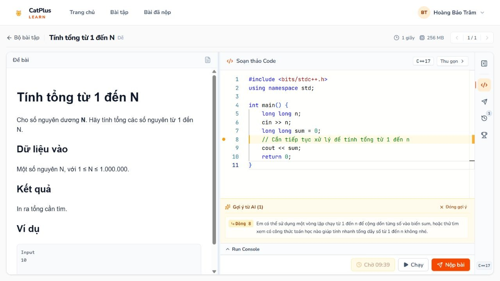

*Hình 3.2. Gợi ý thật được Gemini tạo cho code đang viết dở và được CatPlus gắn tại dòng cần tiếp tục xử lý.*

Các trường hợp từ mục 3.4.2 đến mục 3.4.7 áp dụng khi học viên muốn phân tích lỗi của một lần submit. Học viên cần mở **Lịch sử làm bài**, chọn đúng phiên bản bị lỗi, mở phiên bản đó rồi nhấn nút **Gợi ý với AI**.

AI chỉ phân tích code và kết quả chấm của phiên bản được chọn. AI không phân tích code hiện tại trong trình soạn thảo chính và không tự chuyển sang một lần submit khác. Việc mở phiên bản trong lịch sử cũng không tự thay thế code mà học viên đang viết.

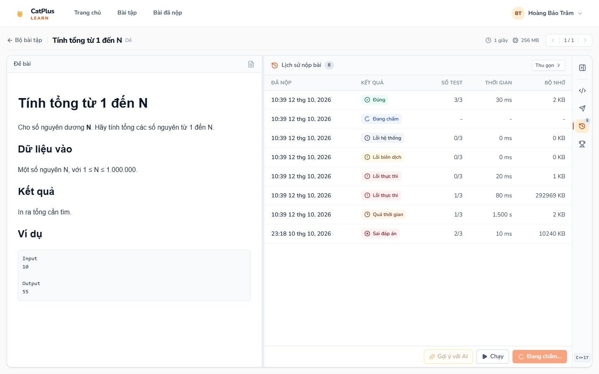

*Hình 3.3. Lịch sử làm bài tập hợp các phiên bản AC, đang chấm, lỗi hệ thống, CE, RTE, MLE, TLE và WA để học viên chọn đúng phiên bản cần xem.*

#### **3.4.2 Phiên bản bị WA**

Trường hợp này áp dụng khi học viên chọn một phiên bản có kết quả WA trong lịch sử làm bài và nhấn nút **Gợi ý với AI**.

AI đọc đúng code của phiên bản được chọn, kết quả WA và những thông tin chấm bài được phép hiển thị. AI đối chiếu code với statement để tìm những vị trí có khả năng làm kết quả bị sai.

Gợi ý có thể đánh dấu đoạn code cần kiểm tra, nhắc về điều kiện biên, yêu cầu tự mô phỏng một ví dụ nhỏ hoặc đặt câu hỏi giúp học viên nhận ra điểm chưa khớp với statement.

Với WA, AI chỉ đưa ra hướng tìm lỗi, không chỉ thẳng cách sửa hoàn chỉnh. AI không cung cấp test ẩn, đáp án ẩn, dòng code sửa chính xác hoặc lời giải đầy đủ.

AI chỉ nhận xét những vấn đề có liên quan đến kết quả WA. Dù nhận thấy nguy cơ TLE, MLE, RTE, CE hoặc một lỗi khác, AI cũng không đưa nội dung đó vào lần gợi ý này.

Bình luận được gắn vào code của phiên bản WA đang xem và không làm thay đổi code hiện tại trong trình soạn thảo chính.

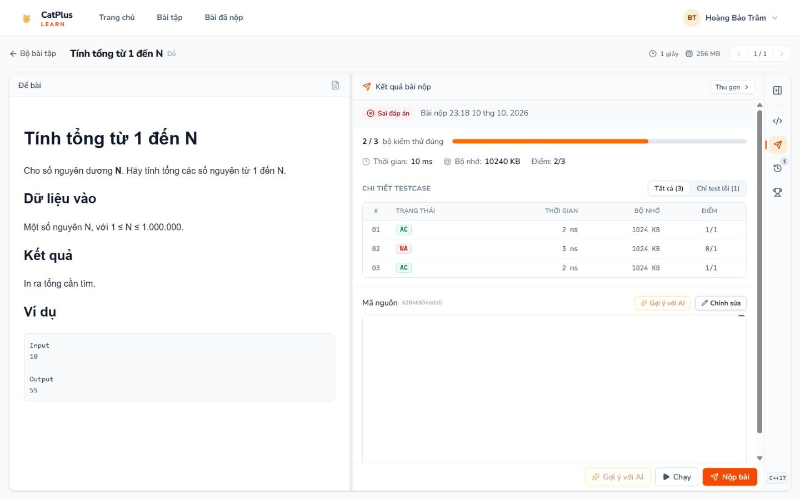

*Hình 3.4. Phiên bản WA hiển thị kết quả từng bộ kiểm thử và có nút gợi ý riêng gắn với đúng code đã submit.*

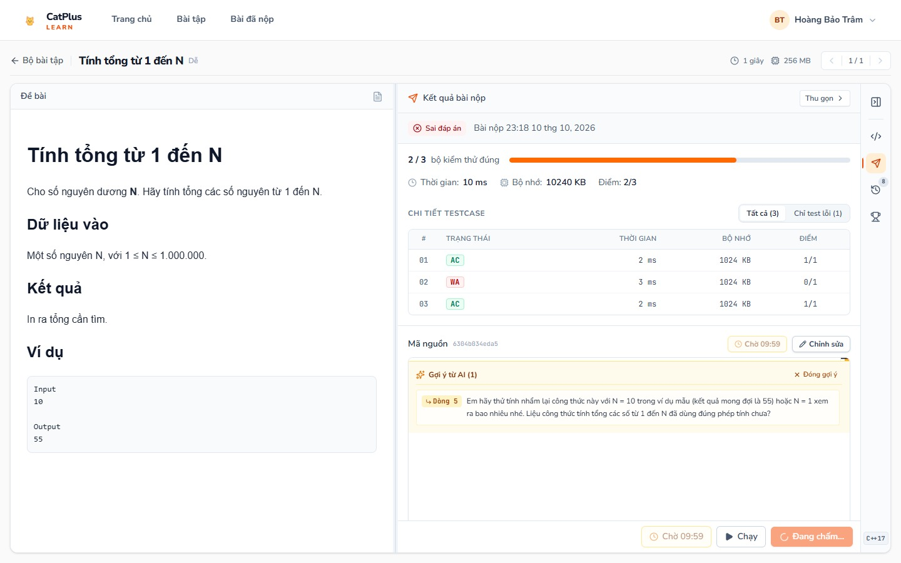

*Hình 3.5. Gemini chỉ đặt câu hỏi giúp học viên tự kiểm tra công thức gây WA tại dòng 5, không cung cấp sẵn dòng code sửa đúng; thời gian chờ được áp dụng sau khi nhận gợi ý thành công.*

#### **3.4.3 Phiên bản bị TLE**

Trường hợp này áp dụng khi học viên chọn một phiên bản có kết quả TLE trong lịch sử làm bài.

AI đọc code của phiên bản được chọn, giới hạn dữ liệu của Problem và giới hạn thời gian chạy. AI xác định những đoạn có nguy cơ xử lý quá lâu, chẳng hạn vòng lặp lồng nhau, thao tác bị lặp lại hoặc cách tìm kiếm phải thực hiện quá nhiều lần.

Gợi ý được đặt tại những dòng có liên quan và tập trung vào hướng giảm số lần xử lý hoặc lựa chọn cách tổ chức dữ liệu phù hợp hơn. AI không viết lại toàn bộ cách giải và không khẳng định một thay đổi chắc chắn hết TLE nếu chưa được submit để kiểm tra lại.

AI chỉ nhận xét nguyên nhân và hướng xử lý liên quan đến TLE, không bổ sung nhận xét về WA, MLE, RTE, CE hoặc lỗi khác.

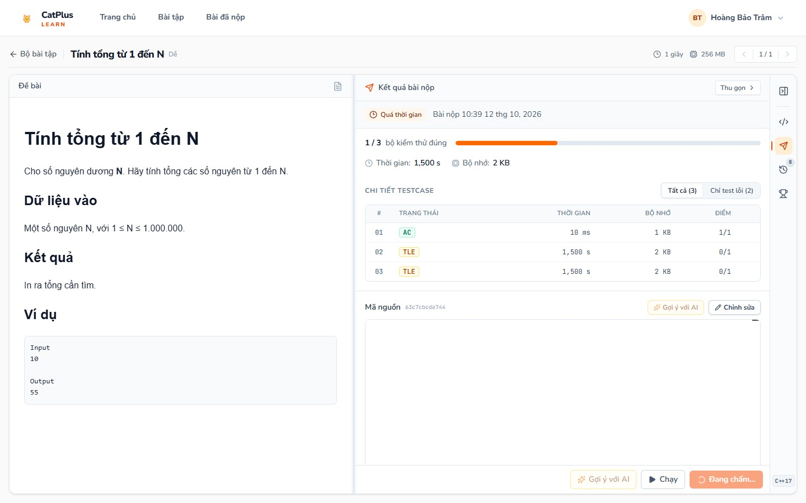

*Hình 3.6. Phiên bản TLE cho biết bộ kiểm thử vượt thời gian, tổng thời gian chạy và code cần được xem xét về hiệu quả xử lý.*

#### **3.4.4 Phiên bản bị MLE**

Trường hợp này áp dụng khi học viên chọn một phiên bản có kết quả MLE trong lịch sử làm bài.

AI đọc code của phiên bản được chọn và giới hạn bộ nhớ của Problem. AI xác định những phần có nguy cơ sử dụng quá nhiều bộ nhớ, chẳng hạn khai báo vùng lưu trữ quá lớn, lưu dữ liệu không cần thiết, tạo nhiều bản sao hoặc giữ dữ liệu lâu hơn nhu cầu sử dụng.

Gợi ý được đặt tại phần code cần xem lại và định hướng cách giảm lượng bộ nhớ sử dụng. Kết quả chỉ được xác nhận sau khi học viên tự sửa và submit lại.

AI chỉ nhận xét nguyên nhân và hướng xử lý liên quan đến MLE, không bổ sung nhận xét về WA, TLE, RTE, CE hoặc lỗi khác.

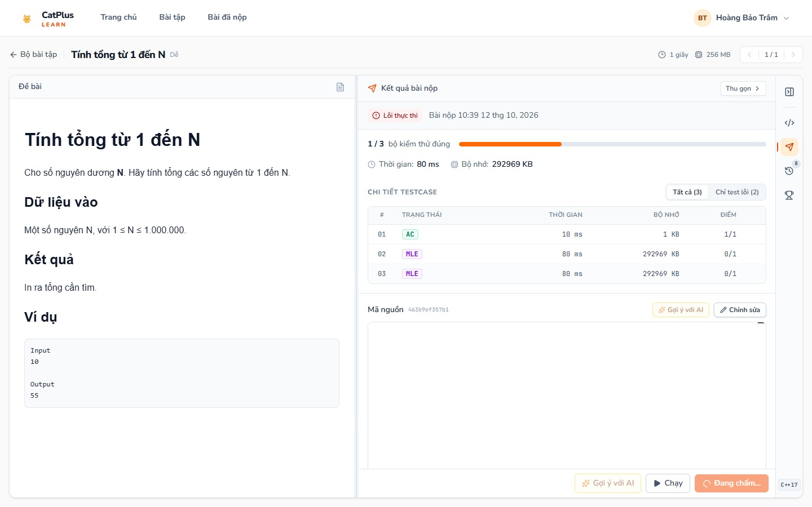

*Hình 3.7. Phiên bản MLE thể hiện lượng bộ nhớ vượt giới hạn tại đúng bộ kiểm thử để học viên chọn phiên bản và yêu cầu hỗ trợ.*

#### **3.4.5 Phiên bản bị RTE**

Trường hợp này áp dụng khi học viên chọn một phiên bản có kết quả RTE trong lịch sử làm bài.

AI đọc code của phiên bản được chọn cùng thông tin lỗi được phép hiển thị. AI kiểm tra những nguyên nhân thường làm chương trình dừng bất thường, chẳng hạn truy cập ngoài phạm vi, chia cho không, sử dụng dữ liệu không hợp lệ, gọi đệ quy quá sâu hoặc đọc dữ liệu sai cách.

AI đặt bình luận ngay tại những dòng có khả năng gây lỗi và giải thích điều kiện có thể làm lỗi xuất hiện.

Khi không đủ căn cứ, AI phải thể hiện đây là vị trí cần kiểm tra, không khẳng định chắc chắn đó là nguyên nhân.

AI chỉ nhận xét nguyên nhân và hướng xử lý liên quan đến RTE, không bổ sung nhận xét về WA, TLE, MLE, CE hoặc lỗi khác.

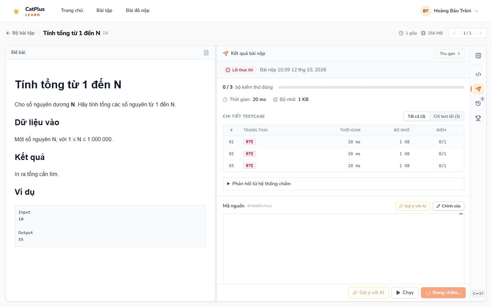

*Hình 3.8. Phiên bản RTE cho biết chương trình dừng bất thường ở các bộ kiểm thử và cung cấp khu vực phản hồi của hệ thống chấm.*

#### **3.4.6 Phiên bản bị CE**

Trường hợp này áp dụng khi học viên chọn một phiên bản có kết quả CE trong lịch sử làm bài.

AI đọc code của phiên bản được chọn và thông báo biên dịch do hệ thống chấm bài trả về. Từ thông báo này, AI xác định vị trí có lỗi cú pháp, sai tên, thiếu khai báo, thiếu ký hiệu hoặc sử dụng kiểu dữ liệu không phù hợp.

AI đặt bình luận tại dòng liên quan và giải thích lỗi bằng nội dung dễ hiểu để học viên tự sửa. Với lỗi cú pháp nhỏ, gợi ý có thể nêu rõ ký hiệu đang thiếu nhưng không thay đổi trực tiếp code.

AI chỉ nhận xét nguyên nhân và hướng xử lý liên quan đến CE, không bổ sung nhận xét về WA, TLE, MLE, RTE hoặc lỗi khác.

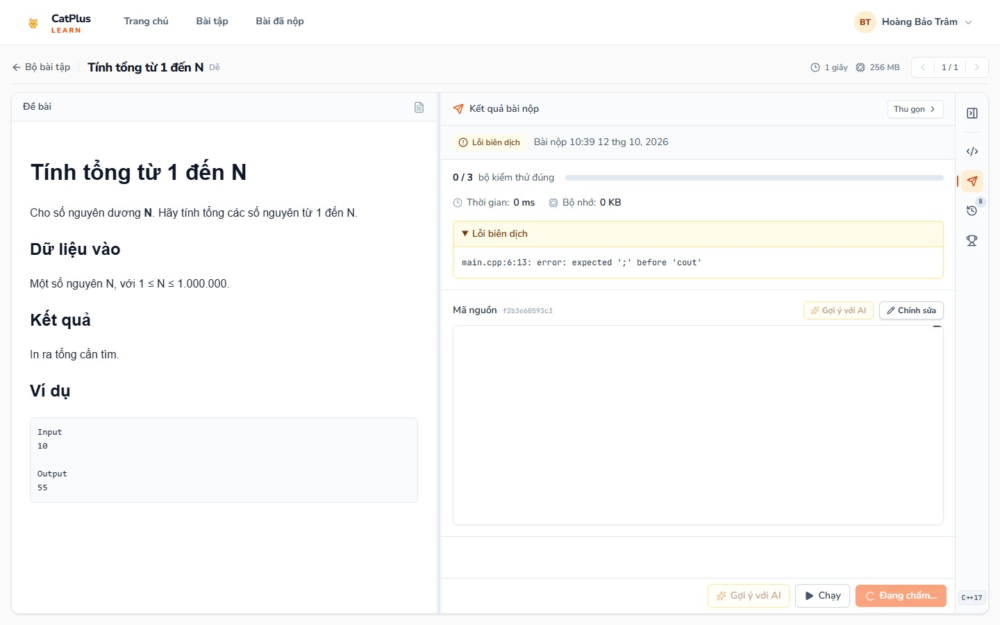

*Hình 3.9. Phiên bản CE hiển thị trực tiếp thông báo của trình biên dịch để AI giải thích đúng lỗi cú pháp đang xảy ra.*

#### **3.4.7 Phiên bản có kết quả lỗi khác**

Trường hợp này áp dụng khi phiên bản được chọn có một kết quả lỗi khác WA, TLE, MLE, RTE hoặc CE.

AI đọc code, tên kết quả chấm và phần thông tin được phép hiển thị của phiên bản đó. Nếu lỗi có liên quan đến code, AI giải thích ý nghĩa của kết quả, đánh dấu vị trí cần kiểm tra và đưa ra hướng xử lý phù hợp.

Nếu thông tin không đủ để xác định nguyên nhân, AI chỉ nêu các khả năng cần kiểm tra và không đưa ra kết luận chắc chắn. Nếu kết quả cho thấy lỗi thuộc hệ thống chấm thay vì code của học viên, AI thông báo rằng chưa thể kết luận về bài làm và hướng dẫn học viên thử submit lại hoặc liên hệ gia sư.

AI chỉ phân tích đúng loại lỗi của phiên bản đang được chọn, không mở rộng sang WA, TLE, MLE, RTE, CE hoặc một loại lỗi không được hệ thống chấm trả về cho phiên bản đó.

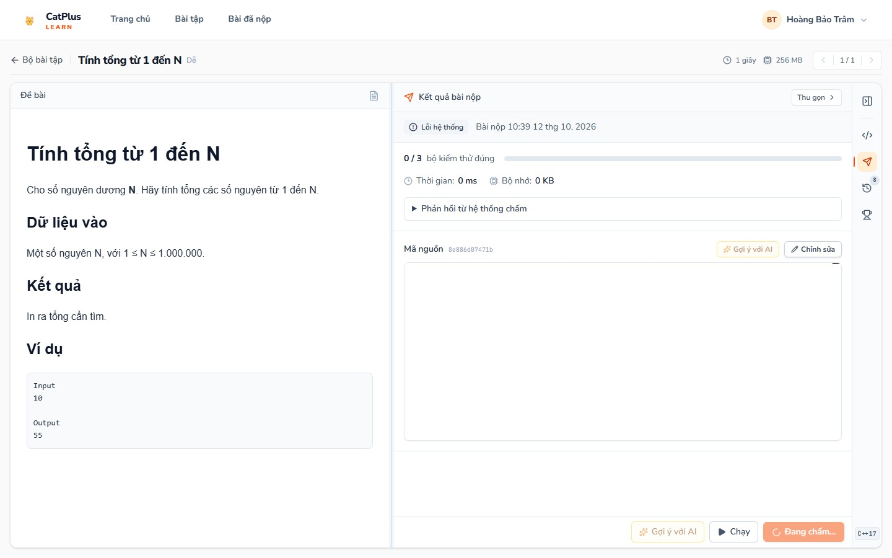

*Hình 3.10. Khi kết quả là lỗi hệ thống, giao diện tách biệt sự cố chấm bài với lỗi code và không quy kết nguyên nhân cho học viên.*

#### **3.4.8 Phiên bản đang chờ chấm**

Trường hợp này áp dụng khi phiên bản được chọn vẫn đang chờ hoặc đang được hệ thống chấm bài xử lý.

Nút **Gợi ý với AI** chưa cho phép phân tích lỗi và hiển thị thông báo yêu cầu học viên chờ kết quả. Sau khi có kết quả hoàn chỉnh, học viên có thể mở lại phiên bản và yêu cầu AI phân tích theo đúng loại lỗi được trả về.

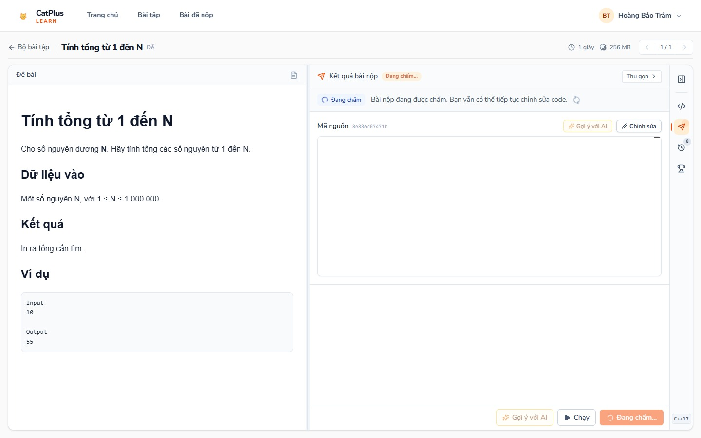

*Hình 3.11. Khi bài nộp đang được chấm, nút gợi ý chưa cho phép phân tích lỗi và học viên được yêu cầu chờ kết quả hoàn chỉnh.*

#### **3.4.9 Phiên bản đã AC**

Trường hợp này áp dụng khi phiên bản được chọn đã có kết quả AC.

Nút phân tích lỗi không được sử dụng vì phiên bản đã được hệ thống chấm xác nhận là đúng. Giao diện thông báo bài đã hoàn thành và không cần gợi ý sửa lỗi.

Việc giải thích cách làm hoặc đề xuất tối ưu cho code đã AC, nếu cần, được xem là một chức năng khác và không thuộc phạm vi chức năng này.

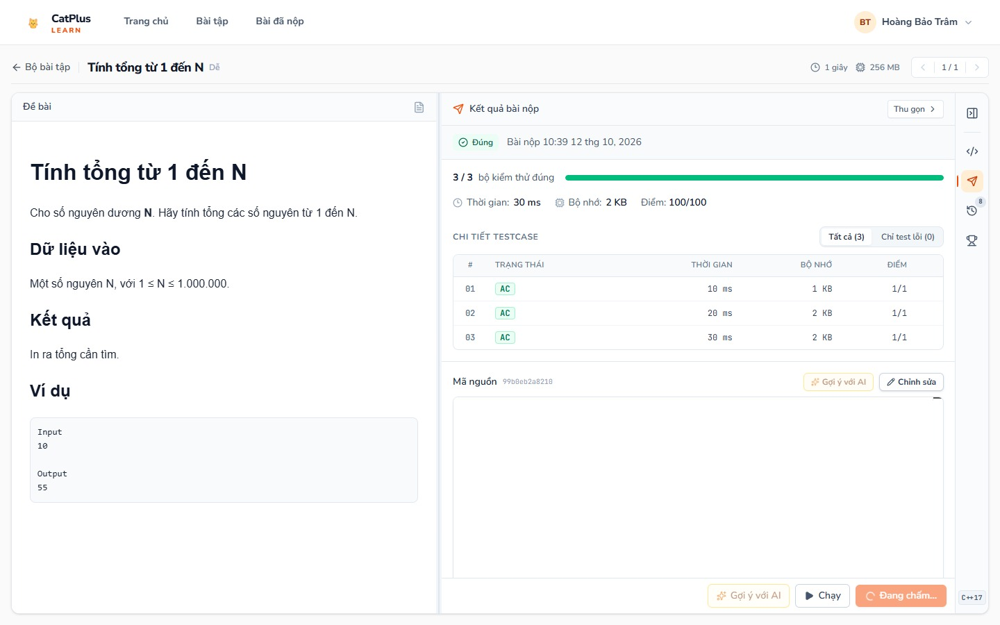

*Hình 3.12. Phiên bản AC hiển thị toàn bộ bộ kiểm thử đã đúng và không cho phép yêu cầu AI phân tích lỗi.*

### **3.5 Thông tin gửi tới Gemini API**

Thông tin được gửi phụ thuộc vào trường hợp học viên đang sử dụng.

Khi gợi ý tại trình soạn thảo chính, thông tin có thể gửi gồm:

- Code hiện tại;
- Ngôn ngữ đang sử dụng;
- Statement, giới hạn và ví dụ công khai;
- Code mẫu nếu có.

Trong trường hợp này, hệ thống không gửi kèm kết quả lỗi của các lần submit trước.

Khi phân tích trong lịch sử làm bài, thông tin có thể gửi thêm:

- Code của phiên bản được chọn;
- Kết quả chấm của phiên bản được chọn;
- Thông báo biên dịch của phiên bản được chọn;
- Thời gian chạy và bộ nhớ được phép hiển thị;
- Những test sai mà học viên đã được phép xem.

Không gửi:

- Toàn bộ test ẩn;
- Đáp án ẩn;
- Code của học viên khác;
- Lời giải chuẩn nội bộ;
- Thông tin cá nhân, liên hệ hoặc tài chính;
- Dữ liệu của lớp khác hoặc học viên khác.

### **3.6 Nguyên tắc đưa ra gợi ý**

AI phải tuân theo các nguyên tắc:

- Mỗi lần sử dụng chỉ phục vụ một mục đích phân tích;
- Khi sử dụng tại trình soạn thảo chính, chỉ hướng dẫn bước tiếp theo và không tự tìm hoặc cảnh báo lỗi;
- Khi phân tích một phiên bản trong lịch sử, chỉ nhận xét đúng loại lỗi mà hệ thống chấm đã trả về;
- Không bổ sung nhận xét về loại lỗi khác, kể cả khi AI phát hiện một nguy cơ khác trong code;
- Chỉ định hướng, không làm bài thay học viên;
- Không đưa toàn bộ code hoàn chỉnh;
- Không đưa lời giải chuẩn;
- Không tiết lộ test ẩn;
- Không sửa trực tiếp code;
- Không thay đổi kết quả chấm;
- Ưu tiên câu hỏi gợi mở;
- Nói rõ khi không đủ dữ liệu để xác định lỗi;
- Không khẳng định chắc chắn khi chỉ đang phỏng đoán.

Mỗi lần sử dụng chỉ nên hiển thị từ một đến năm bình luận quan trọng nhất. Bình luận phải ngắn gọn, dễ hiểu và gắn với dòng code có liên quan.

### **3.7 Giới hạn sử dụng**

Học viên được sử dụng chức năng khi đáp ứng một trong các điều kiện:

- Chưa từng nhận gợi ý cho Problem đó; lượt đầu tiên được sử dụng ngay khi đã có code, không cần submit trước;
- Đã qua mười phút kể từ lần nhận gợi ý thành công gần nhất trên cùng Problem;
- Đã có một lần submit chính thức mới với code thay đổi và lần submit đó đã có kết quả.

Các trường hợp không mở thêm lượt sử dụng:

- Chỉ chạy thử code;
- Submit lại cùng nội dung;
- Submit mới nhưng vẫn đang chờ chấm;
- Gửi lại yêu cầu AI khi yêu cầu trước vẫn đang xử lý.

Nếu yêu cầu Gemini API thất bại trước khi nhận được gợi ý, học viên không bị mất lượt.

Trong thời gian chờ, nút hiển thị thời gian còn lại. Thời gian mười phút được cấu hình để có thể điều chỉnh sau khi đánh giá thực tế.

### **3.8 Trạng thái của nút gợi ý**

Nút **Gợi ý với AI** có các trạng thái chính:

- Có thể sử dụng;
- Đang phân tích;
- Đang trong thời gian chờ;
- Đang chờ kết quả chấm;
- Không có code để phân tích;
- Bài đã AC;
- Chức năng tạm thời không khả dụng;
- Học viên không có quyền với Problem.

Tại trình soạn thảo chính, trạng thái của nút được xác định theo code hiện tại. Tại lịch sử làm bài, trạng thái của nút được xác định theo phiên bản submit đang được mở; phiên bản chưa có kết quả hoàn chỉnh không thể yêu cầu phân tích lỗi.

Nếu Gemini API không khả dụng, code của học viên vẫn được giữ nguyên và các chức năng Chạy thử, Submit vẫn hoạt động bình thường.

### **3.9 Quản lý và theo dõi sử dụng**

Hiện tại, người vận hành có thể bật hoặc tắt chức năng cho toàn hệ thống và thay đổi thời gian chờ thông qua cấu hình triển khai.

Các khả năng sau **chưa được triển khai trên giao diện quản trị**:

- Bật hoặc tắt theo từng lớp hoặc từng Problem;
- Đặt số lượt tối đa trong ngày;
- Xem số lần sử dụng theo học viên hoặc lớp;
- Xem tỷ lệ gợi ý được đánh giá hữu ích;
- Cho học viên đánh giá từng gợi ý là **Hữu ích** hoặc **Chưa hữu ích**.

Hệ thống không lưu nội dung gợi ý, prompt hoàn chỉnh, code gửi tới AI hoặc bình luận do AI tạo ra. Hệ thống chỉ giữ tạm trong cache những thông tin tối thiểu cần thiết để kiểm soát lượt sử dụng, chẳng hạn học viên, Problem, thời điểm sử dụng thành công gần nhất và phiên bản submit đã mở lượt mới.

Nếu chức năng thống kê được triển khai trong tương lai, hệ thống chỉ sử dụng số liệu tổng hợp như số lượt gọi thành công, số lượt thất bại và đánh giá hữu ích, không lưu kèm nội dung gợi ý. CatPlus không tự dùng dữ liệu này để huấn luyện một mô hình AI riêng.

### **3.10 Thông báo cho học viên**

Trước lần sử dụng đầu tiên, hệ thống thông báo:

- Code sẽ được gửi tới Gemini API để phân tích;
- Gợi ý có thể chưa chính xác hoàn toàn;
- Học viên cần tự kiểm tra và submit để xác nhận;
- AI không thay thế gia sư;
- AI không tự sửa code của học viên.

Nếu AI không thể tạo gợi ý đủ tin cậy, hệ thống hiển thị thông báo yêu cầu học viên kiểm tra lại statement, tự thử với ví dụ nhỏ hoặc hỏi gia sư, thay vì tạo bình luận chung chung.

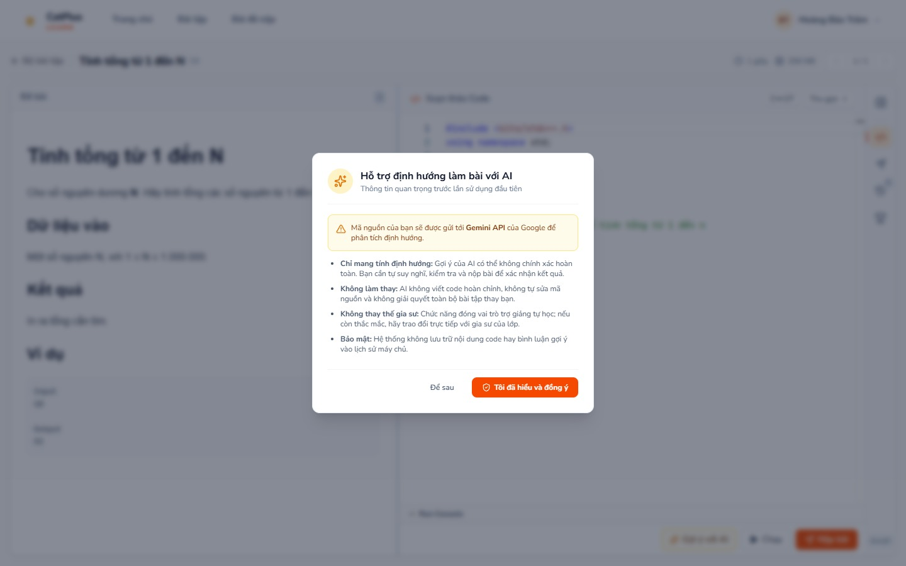

*Hình 3.13. Thông báo trước lần sử dụng đầu tiên nêu rõ dữ liệu được gửi, giới hạn của gợi ý và trách nhiệm tự kiểm tra của học viên.*

### **3.11 Các yêu cầu nghiệp vụ đã triển khai**

Phần chức năng đã triển khai được xây dựng theo các yêu cầu sau:

1. Nút tại trình soạn thảo chính luôn yêu cầu gợi ý cho code hiện tại.
2. Học viên chưa submit vẫn nhận được định hướng nhưng không nhận lời giải hoàn chỉnh.
3. Muốn phân tích một lỗi chấm bài, học viên phải mở lịch sử làm bài và chọn đúng phiên bản bị lỗi.
4. Nút tại phiên bản lịch sử chỉ phân tích code và kết quả của phiên bản đang được chọn.
5. Hệ thống không tự ghép kết quả của phiên bản cũ với code hiện tại.
6. Gợi ý cho code hiện tại chỉ hướng dẫn bước tiếp theo và không cảnh báo thêm các lỗi có thể xảy ra.
7. Khi phân tích phiên bản lỗi, AI chỉ nhận xét đúng loại lỗi mà hệ thống chấm đã trả về.
8. Trường hợp WA chỉ nhận hướng tìm lỗi và không bị lộ test ẩn.
9. TLE, MLE, RTE và CE được giải thích tại dòng có liên quan khi đủ căn cứ.
10. Bình luận AI không tự thay đổi code thật.
11. Phiên bản đang chờ chấm không bị phân tích như đã có kết quả.
12. Phiên bản đã AC không nhận gợi ý sửa lỗi.
13. Giới hạn mười phút và mở lại sau submit mới hoạt động đúng.
14. Chạy thử hoặc submit trùng code không thể dùng để vượt giới hạn.
15. Chức năng gọi đúng Gemini API với mô hình `gemini-3.8-flash` và mức suy luận `high`.
16. Lỗi từ Gemini API không làm mất code hoặc cản trở việc submit.
17. Nội dung gợi ý, prompt hoàn chỉnh và code gửi tới AI không được lưu trong cơ sở dữ liệu hoặc cache.
18. Cache chỉ giữ thông tin tối thiểu phục vụ giới hạn sử dụng và tự hết hạn theo thời gian được cấu hình.

### **3.12 Cách chức năng đang được triển khai**

Chức năng được triển khai thành một phần của cổng học tập CatPlus, không phải một trang trò chuyện AI riêng. Học viên vẫn làm bài trong không gian viết code hiện có; CatPlus bổ sung nút gợi ý, phần xử lý tại máy chủ và kết nối tới Gemini.

Các thành phần đang phối hợp theo luồng sau:

```text
Trình soạn thảo hoặc chi tiết phiên bản submit
        ↓
Giao diện gửi yêu cầu gợi ý tới máy chủ CatPlus
        ↓
Máy chủ kiểm tra quyền, trạng thái bài và giới hạn sử dụng
        ↓
Máy chủ xác định code hiện tại hoặc phiên bản đã submit
        ↓
Chọn bộ yêu cầu cố định theo đúng trường hợp
        ↓
Gemini 3.8 Flash High tạo danh sách bình luận
        ↓
Giao diện đánh dấu dòng code và hiển thị bình luận tạm thời
```

Trình duyệt không gửi yêu cầu trực tiếp tới Google. Mọi yêu cầu đều đi qua máy chủ CatPlus để quyền truy cập, kết quả chấm, giới hạn lượt và phạm vi phân tích không thể bị học viên tự thay đổi.

#### **3.12.1 Tiếp nhận yêu cầu từ giao diện**

Tại trình soạn thảo chính, giao diện gửi mã Problem, code hiện tại và ngôn ngữ lập trình. Yêu cầu này luôn được xác định là yêu cầu hướng dẫn bước tiếp theo.

Tại lịch sử làm bài, giao diện chỉ gửi mã phiên bản submit được học viên chọn. Hệ thống tự đọc code, kết quả chấm và thông tin liên quan của phiên bản đó. Giao diện không được tự khai báo hoặc thay đổi loại lỗi.

#### **3.12.2 Kiểm tra trước khi gọi AI**

Hệ thống kiểm tra:

- Học viên đã đăng nhập;
- Học viên có quyền truy cập Problem;
- Phiên bản submit thuộc đúng học viên;
- Chức năng AI đang được bật;
- Học viên còn lượt sử dụng;
- Không có yêu cầu AI khác của cùng học viên và Problem đang được xử lý.

Nếu không đáp ứng điều kiện, hệ thống trả thông báo phù hợp và không gọi Gemini API.

#### **3.12.3 Xác định phạm vi phân tích**

Phạm vi do hệ thống tự xác định:

- Nhấn nút tại trình soạn thảo chính: hướng dẫn bước tiếp theo;
- Chọn phiên bản WA: chỉ phân tích WA;
- Chọn phiên bản TLE: chỉ phân tích TLE;
- Chọn phiên bản MLE: chỉ phân tích MLE;
- Chọn phiên bản RTE: chỉ phân tích RTE;
- Chọn phiên bản CE: chỉ phân tích CE;
- Chọn phiên bản có lỗi khác: chỉ phân tích đúng lỗi được hệ thống chấm trả về.

Học viên không thể tự gửi một loại lỗi khác với kết quả thật của phiên bản đã chọn.

#### **3.12.4 Chuẩn bị thông tin gửi tới Gemini**

Với yêu cầu tại trình soạn thảo chính, hệ thống chỉ chuẩn bị code hiện tại, ngôn ngữ, statement và các thông tin công khai của Problem. Kết quả submit cũ không được đưa vào yêu cầu.

Với yêu cầu từ lịch sử làm bài, hệ thống chuẩn bị đúng code của phiên bản được chọn, loại lỗi, thông báo chấm bài được phép hiển thị và thông tin công khai của Problem. Code hiện tại và các phiên bản submit khác không được đưa vào yêu cầu.

#### **3.12.5 Sử dụng bộ yêu cầu AI cố định**

Hệ thống duy trì một bộ yêu cầu chung và các bộ yêu cầu riêng cho từng phạm vi như hướng dẫn bước tiếp theo, WA, TLE, MLE, RTE, CE và lỗi khác.

Mỗi lần gọi, hệ thống tự chọn bộ yêu cầu phù hợp rồi ghép với dữ liệu của bài làm. Người vận hành không cần viết lại prompt cho từng yêu cầu và học viên không được nhập prompt tự do.

Bộ yêu cầu được đánh số phiên bản để có thể kiểm tra, so sánh và quay lại phiên bản trước khi cần. Mọi thay đổi về cách AI phản hồi được thực hiện tập trung tại bộ yêu cầu này.

Bộ yêu cầu phải mô tả đầy đủ phạm vi được phép trả lời, nội dung bị cấm, số lượng bình luận, cách gắn bình luận vào dòng code và cấu trúc dữ liệu cần trả về. Đây là cơ chế chính được sử dụng để kiểm soát nội dung phản hồi của AI.

##### **3.12.5.1 Giới hạn hiện tại của bộ yêu cầu gửi Gemini**

Bộ yêu cầu hiện tại đã quy định được phạm vi trả lời và những nội dung Gemini không được cung cấp. Tuy nhiên, cách thiết kế vẫn còn một số điểm chưa được xác định đầy đủ:

1. **Chưa cá nhân hóa theo trình độ học viên:** Gemini hiện nhận đề bài và code nhưng chưa nhận thông tin về lớp, độ tuổi, kiến thức học viên đã học hoặc mức độ gợi ý phù hợp với từng người. Vì vậy, cùng một đoạn code có thể nhận cách giải thích giống nhau dù năng lực của hai học viên khác nhau.
2. **Quy tắc chỉ phân tích một phạm vi có thể quá cứng:** Việc chỉ nói về WA, TLE, MLE, RTE hoặc CE giúp gợi ý tập trung, nhưng chưa xác định cách xử lý khi một nguyên nhân nền tảng có liên quan trực tiếp đến nhiều loại lỗi. Cần làm rõ trường hợp nào vẫn phải giữ tuyệt đối một phạm vi và trường hợp nào được phép nhắc ngắn gọn điều kiện liên quan.
3. **Chưa có mức gợi ý tăng dần:** Mỗi yêu cầu được xử lý độc lập và hệ thống không lưu nội dung gợi ý trước. Nếu học viên vẫn chưa hiểu, AI có thể lặp lại gợi ý tương tự thay vì chuyển từ câu hỏi gợi mở sang giải thích cụ thể hơn.
4. **Cấu trúc kết quả còn đơn giản:** Gemini chỉ trả số dòng và nội dung bình luận. Kết quả chưa có thông tin về mục đích của bình luận, mức độ chắc chắn hoặc mức độ gợi ý, nên giao diện chưa thể phân biệt rõ câu hỏi gợi mở, cảnh báo và hướng dẫn kiểm tra.
5. **Chưa có tiêu chí đánh giá chất lượng sư phạm:** Kiểm thử hiện xác nhận đúng phạm vi, đúng cấu trúc và không lộ dữ liệu cấm, nhưng chưa có thang đánh giá thống nhất để xác định một gợi ý có vừa sức, dễ hiểu và thực sự giúp học viên tự suy nghĩ hay không.
6. **Chưa quy định quy trình duyệt khi thay đổi bộ yêu cầu:** Bộ yêu cầu đã có số phiên bản nhưng chưa xác định ai được phép sửa, cần thử nghiệm trên nhóm bài nào và dựa vào tiêu chí nào để chấp nhận một phiên bản mới.

Những điểm trên không làm thay đổi luồng chức năng đã triển khai, nhưng ảnh hưởng trực tiếp tới chất lượng hướng dẫn khi đưa vào sử dụng thật. Việc hoàn thiện bộ yêu cầu cần cân bằng giữa cá nhân hóa, tính sư phạm, bảo mật và yêu cầu không làm bài thay học viên.

#### **3.12.6 Gọi Gemini API**

Máy chủ CatPlus gọi Gemini API bằng khóa truy cập được bảo vệ ở phía máy chủ. Trình duyệt của học viên không gọi trực tiếp Gemini và không nhận được khóa truy cập.

Mỗi yêu cầu được xử lý độc lập, không sử dụng lại cuộc hội thoại của lần gọi trước. Điều này tránh nội dung của Problem, phiên bản hoặc loại lỗi trước ảnh hưởng đến kết quả hiện tại.

Gemini trả về danh sách bình luận theo cấu trúc cố định, trong đó mỗi bình luận có dòng code và nội dung gợi ý. CatPlus kiểm tra cấu trúc tối thiểu như số lượng bình luận và số dòng có tồn tại trong code hay không. Hệ thống không dùng một AI khác để chấm lại nội dung và không tự quyết định gợi ý đó có giải đúng bài hay không; học viên vẫn phải tự sửa và submit để xác nhận.

#### **3.12.7 Hiển thị gợi ý trên code**

Sau khi Gemini trả về kết quả thành công, các gợi ý được chuyển trực tiếp tới giao diện và hiển thị dưới dạng bình luận tại những dòng code phù hợp.

Bình luận AI chỉ tồn tại trong phiên làm việc hiện tại, không được chèn vào code thật và không được lưu vào cơ sở dữ liệu hoặc cache. Khi học viên tải lại trang hoặc rời khỏi màn hình, các bình luận này biến mất.

#### **3.12.8 Quản lý giới hạn bằng cache**

Cache được sử dụng để giữ tạm:

- Học viên và Problem đang sử dụng chức năng;
- Thời điểm nhận gợi ý thành công gần nhất;
- Phiên bản submit đã được dùng để mở lượt mới;
- Trạng thái yêu cầu đang được xử lý;
- Phiên bản bộ yêu cầu AI đang sử dụng.

Cache không chứa code, statement, prompt hoàn chỉnh hoặc nội dung gợi ý. Dữ liệu giới hạn tự hết hạn theo thời gian được cấu hình.

Cache chỉ được cập nhật sau khi Gemini API trả về kết quả thành công. Nếu yêu cầu Gemini API thất bại, học viên không bị mất lượt.

#### **3.12.9 Xử lý lỗi**

Nếu Gemini API không khả dụng, phản hồi quá lâu hoặc không trả về được dữ liệu để hiển thị, hệ thống:

- Giữ nguyên code của học viên;
- Không lưu nội dung yêu cầu hoặc phản hồi;
- Không tính lượt sử dụng;
- Giải phóng trạng thái đang xử lý trong cache;
- Thông báo học viên thử lại sau.

Các chức năng Chạy thử và Submit vẫn hoạt động bình thường khi chức năng AI gặp lỗi.

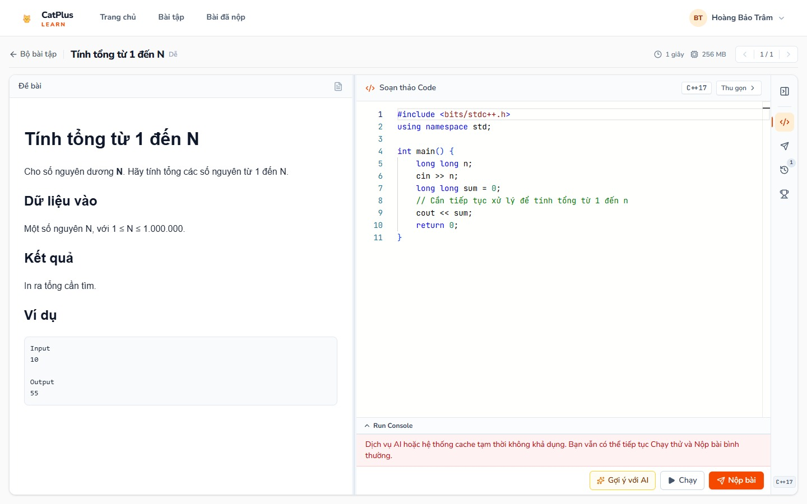

*Hình 3.14. Trường hợp yêu cầu AI không hoàn thành: code được giữ nguyên và các thao tác Chạy, Nộp bài vẫn khả dụng.*

#### **3.12.10 Cấu hình và đưa chức năng vào sử dụng**

Chức năng được đặt sau một cấu hình bật hoặc tắt toàn hệ thống. Trạng thái mặc định là tắt để việc thiếu khóa Gemini hoặc lỗi dịch vụ AI không ảnh hưởng tới chức năng làm bài đang có.

Khi triển khai cho môi trường sử dụng thật, người vận hành cần cấu hình tại máy chủ:

- Bật chức năng gợi ý AI;
- Cấp khóa truy cập Gemini;
- Xác định mô hình `gemini-3.8-flash` và mức suy luận `high`;
- Xác định thời gian chờ giữa hai lượt, hiện mặc định là mười phút;
- Kết nối Redis để quản lý thời gian chờ và khóa yêu cầu đang xử lý;
- Cấp cho dịch vụ OJ một đường mạng đi ra ngoài có kiểm soát tới Gemini API;
- Đặt thời gian chờ của tiến trình phục vụ lớn hơn tổng thời gian tối đa của một yêu cầu Gemini và các lần thử lại.

Khóa Gemini chỉ tồn tại trong cấu hình phía máy chủ, không được ghi vào mã nguồn, không được gửi tới trình duyệt và không xuất hiện trong tài liệu của học viên.

Sau khi cấu hình, dịch vụ chấm bài được khởi động lại để nhận thiết lập mới. Giao diện tự đọc trạng thái từ máy chủ: khi chức năng tắt hoặc tạm thời không khả dụng, học viên không thể gửi yêu cầu tới Gemini nhưng vẫn có thể Chạy thử và Submit như bình thường.

#### **3.12.11 Kiểm thử chức năng**

Bộ kiểm thử tự động đã bao phủ các trường hợp chính:

- Code hiện tại có lỗi rõ ràng nhưng AI chỉ hướng dẫn bước tiếp theo;
- Phiên bản WA đồng thời có nguy cơ TLE nhưng AI chỉ nhận xét WA;
- Phiên bản TLE có nguy cơ RTE nhưng AI chỉ nhận xét TLE;
- Phiên bản CE có thuật toán sai nhưng AI chỉ nhận xét CE;
- Phiên bản đang chờ chấm không được gửi tới Gemini để phân tích lỗi;
- Nhiều lần nhấn nút đồng thời chỉ tạo một yêu cầu;
- Gemini thất bại không làm mất lượt;
- Tải lại trang làm các bình luận AI biến mất;
- Code, prompt và nội dung gợi ý không xuất hiện trong cơ sở dữ liệu, cache hoặc nhật ký hệ thống.

#### **3.12.12 Chuỗi bước triển khai và xử lý trên giao diện**

Các bước triển khai được thể hiện qua các ảnh giao diện theo trình tự sau:

1. **Gắn điểm gọi AI vào trình soạn thảo:** Nút **Gợi ý với AI** được đặt cùng các thao tác Chạy và Nộp bài như Hình 3.1.
2. **Yêu cầu xác nhận trước lần đầu sử dụng:** Học viên phải đọc và đồng ý với phạm vi sử dụng dữ liệu như Hình 3.13.
3. **Xác định nguồn code cần phân tích:** Nếu gọi tại trình soạn thảo, hệ thống dùng code hiện tại; nếu gọi tại lịch sử, học viên phải chọn đúng phiên bản như Hình 3.3 và Hình 3.4.
4. **Xác định phạm vi tại máy chủ:** Máy chủ đọc kết quả chấm của phiên bản để chọn riêng bộ yêu cầu WA, TLE, MLE, RTE, CE hoặc lỗi khác. Trình duyệt không được tự khai báo loại lỗi.
5. **Gọi Gemini và nhận dữ liệu có cấu trúc:** Sau khi học viên xác nhận yêu cầu, nút chuyển sang trạng thái **Đang phân tích...** để ngăn việc gửi trùng yêu cầu trong lúc máy chủ đang xử lý. Gemini trả danh sách gồm dòng code và nội dung bình luận theo đúng phạm vi lỗi. Trường hợp code hiện tại được thể hiện tại Hình 3.2; trường hợp WA được thể hiện tại Hình 3.5; các trường hợp phân tích lỗi biên dịch và lỗi thực thi thuật toán phức tạp (CE, TLE, MLE, RTE, OLE) được minh họa thực tế qua bài toán Dijkstra từ Hình 3.15 đến Hình 3.19.
6. **Hiển thị và giới hạn lượt:** Bình luận được đặt cạnh dòng code, đồng thời nút chuyển sang thời gian chờ mười phút như Hình 3.2, Hình 3.5 và các minh họa kết quả từ Hình 3.15 đến Hình 3.19.
7. **Xử lý khi không nhận được phản hồi:** Giao diện hiển thị thông báo có kiểm soát, giữ nguyên code và các thao tác làm bài như Hình 3.14.
8. **Không gọi AI khi chưa có phạm vi phù hợp:** Phiên bản đang chấm và phiên bản AC không được gửi tới Gemini, tương ứng Hình 3.11 và Hình 3.12.

### **3.13 Hiện trạng triển khai và kết quả kiểm tra**

#### **3.13.1 Phần đã triển khai**

CatPlus đã triển khai các thành phần chính của chức năng:

- Nút **Gợi ý với AI** tại trình soạn thảo cho code hiện tại;
- Nút **Gợi ý với AI** tại chi tiết một phiên bản submit chưa đạt;
- Hộp thoại thông báo và yêu cầu học viên đồng ý trước lần sử dụng đầu tiên;
- Phân tách đúng hai trường hợp: định hướng bước tiếp theo cho code hiện tại và phân tích đúng phiên bản trong lịch sử;
- Các bộ yêu cầu riêng cho WA, TLE, MLE, RTE, CE và lỗi khác;
- Xác định loại lỗi từ kết quả chấm ở máy chủ, không tin loại lỗi do trình duyệt tự gửi;
- Hiển thị gợi ý tại dòng code và trong danh sách gợi ý;
- Xóa gợi ý khi code thay đổi, khi chuyển phiên bản hoặc khi tải lại trang;
- Giới hạn mười phút, mở lại lượt sau một bản submit mới đủ điều kiện và ngăn nhiều yêu cầu đồng thời;
- Chỉ lưu tạm thông tin cần thiết để quản lý lượt, không lưu code, prompt hoàn chỉnh hoặc nội dung gợi ý;
- Thông báo lỗi có kiểm soát khi bộ nhớ đệm hoặc Gemini không khả dụng mà không ảnh hưởng đến Chạy thử và Submit.

#### **3.13.2 Kết quả kiểm tra**

Kết quả kiểm tra tại môi trường cục bộ:

- Toàn bộ các dịch vụ dài hạn của dự án đã chạy; các dịch vụ có kiểm tra sức khỏe đều báo hoạt động bình thường;
- Giao diện quản trị và giao diện học viên đều phản hồi thành công;
- **102** kiểm thử phía máy chủ (backend) dành riêng cho chức năng AI đã đạt;
- **9** kiểm thử phần xử lý giao diện học viên (frontend) đã đạt;
- Kiểm tra kiểu dữ liệu TypeScript không có lỗi;
- Tạo ảnh Docker và cấu hình dịch vụ (`compose config`) thành công, kiểm tra hệ thống Django (`manage.py check`) và đóng gói bản phát hành (`production build`) đều vượt qua mà không có lỗi;
- Luồng giao diện từ bộ bài tập, trình soạn thảo, hộp thoại đồng ý, lịch sử submit đến chi tiết từng phiên bản lỗi đã được mở và kiểm tra trực tiếp;
- Một yêu cầu thật cho code hiện tại đã được Gemini xử lý thành công và trả một gợi ý tại dòng 8;
- Một yêu cầu thật cho phiên bản WA đã được Gemini xử lý thành công; gợi ý chỉ yêu cầu học viên tự kiểm tra công thức tại dòng 5, không tiết lộ trực tiếp cách sửa;
- Đợt kiểm chứng mở rộng trên bài toán thuật toán đồ thị phức tạp **Đường đi ngắn nhất bằng Dijkstra** với 5 trạng thái lỗi kỹ thuật điển hình (CE, TLE, MLE, RTE, OLE) đều nhận phản hồi gợi ý sư phạm thành công từ Gemini thật;
- Gợi ý được hiển thị đúng dưới dạng bình luận tại chính xác dòng code cần chú ý, không thay đổi mã nguồn của học viên và nút chuyển sang thời gian chờ mười phút sau khi nhận kết quả thành công;
- Trường hợp code chưa đủ thông tin được Gemini trả về theo trạng thái không thể đưa ra gợi ý hữu ích;
- Trường hợp dịch vụ không hoàn thành yêu cầu được giao diện xử lý có kiểm soát, giữ nguyên code và không chặn Chạy hoặc Nộp bài.

#### **3.13.3 Kết quả kiểm chứng thực tế trên bài toán Dijkstra và hoàn thiện hạ tầng triển khai**

Chức năng hỗ trợ định hướng bằng AI đã được bật trong cấu hình hệ thống, kết nối chính xác tới mô hình `gemini-3.8-flash` với mức suy luận `high`. Luồng đầu cuối đã được vận hành: yêu cầu gửi từ trình duyệt qua lớp xử lý máy chủ CatPlus tới Gemini API, phản hồi quay lại dưới dạng dữ liệu có cấu trúc và được hiển thị trực tiếp thành các bình luận tương ứng tại từng dòng code.

##### **3.13.3.1 Hoàn thiện hạ tầng mạng, chuỗi thời gian chờ và cơ chế chịu lỗi**

Các điểm nghẽn về hạ tầng triển khai trước đây đã được cấu hình và xử lý:

- **Đường mạng đi ra ngoài (Outbound network):** Dịch vụ `oj-api` đã được cấu hình kết nối mạng ra ngoài có kiểm soát, cho phép kết nối tới các dịch vụ của Google Gemini API;
- **Chuỗi cấu hình thời gian chờ phân tầng (Timeout hierarchy):** Nhằm giảm thiểu nguy cơ tiến trình máy chủ bị ngắt do vượt quá thời gian chờ khi Gemini đang phân tích các bài toán phức tạp, hệ thống thiết lập chuỗi thời gian chờ có thứ bậc tăng dần:

    $$
    {\small \text{Gemini API (62 giây)} < \text{Gunicorn worker (70 giây)} < \text{Nginx proxy (80 giây)} < \text{Redis distributed lock (90 giây)}}
    $$

    Cơ chế này đảm bảo Gunicorn và Nginx luôn đủ thời gian chờ phản hồi từ Gemini và kịp thời trả dữ liệu có cấu trúc hoặc thông báo lỗi có kiểm soát về trình duyệt, trong khi khóa phân tán Redis chỉ hết hạn sau khi toàn bộ chu trình xử lý đã kết thúc an toàn;

- **Cơ chế chịu lỗi với hai khóa API (Two-key sticky failover):** Hệ thống hỗ trợ cấu hình đồng thời 2 khóa API thông qua biến môi trường `GEMINI_API_KEYS`. Khi gặp sự cố vượt giới hạn hạn mức (mã lỗi HTTP 429 hoặc `RESOURCE_EXHAUSTED`), hệ thống sẽ tự động chuyển đổi (failover) sang khóa dự phòng và duy trì tiếp tục (sticky) trên khóa mới, giúp ngăn ngừa tình trạng gián đoạn dịch vụ khi có lượng truy cập cao. Toàn bộ khóa API đều được bảo mật ở lớp máy chủ, không lưu trong mã nguồn, không truyền xuống trình duyệt và không hiển thị trong tài liệu.

##### **3.13.3.2 Phương pháp kiểm chứng thực tế trên bài toán thuật toán Dijkstra**

Để đánh giá toàn diện năng lực phản hồi và định hướng của Gemini trên các bài toán thuật toán có cấu trúc dữ liệu và độ phức tạp cao, hệ thống đã thực hiện đợt kiểm chứng đầu cuối mở rộng trên bài toán:

- **Tên bài:** `Đường đi ngắn nhất bằng Dijkstra`
- **Độ khó:** `MEDIUM` (Trung bình)
- **Giới hạn tài nguyên:** Thời gian chạy $1.0\text{ giây}$, bộ nhớ $256\text{ MiB}$
- **Quy mô dữ liệu:** Số đỉnh $N \le 100\,000$, số cạnh $M \le 200\,000$, trọng số cạnh nguyên dương $w \le 10^9$.

*Lưu ý về phương pháp kiểm chứng (Controlled evidence fixtures và Live Gemini/UI):*
Các trạng thái submit gồm CE, TLE, MLE, RTE và OLE được thiết lập dưới dạng các bộ dữ liệu kiểm chứng có kiểm soát (controlled evidence fixtures) chuẩn mực kỹ thuật cho bài toán Dijkstra nhằm phục vụ thử nghiệm giao diện và kiểm tra năng lực bắt lỗi chuyên biệt của AI. Tài liệu ghi chú trung thực rằng các trạng thái kết quả chấm này là fixture, không đại diện cho việc máy chấm DMOJ đã thực hiện những lượt chấm chính thức tương ứng. Tuy nhiên, toàn bộ luồng kết nối tới Google Gemini API (mô hình `gemini-3.8-flash`, suy luận `high`), việc trích xuất dữ liệu phản hồi có cấu trúc và hiển thị trực tiếp các bình luận trên giao diện CatPlus đều được thực hiện thật theo thời gian thực.

##### **3.13.3.3 Minh chứng thực tế qua 5 trạng thái lỗi kỹ thuật điển hình**

Kết quả kiểm chứng thực tế được ghi nhận qua 5 trường hợp giao diện tương ứng với các trạng thái lỗi thuật toán:

1. **Trường hợp Lỗi biên dịch (CE - Compilation Error):**
Mã nguồn định nghĩa cấu trúc cạnh của đồ thị (`struct Edge`) nhưng thiếu dấu chấm phẩy `;` kết thúc cấu trúc ở dòng 13 (`solution.cpp:14:2: error: expected ';' after struct definition`). Gemini trích xuất chính xác thông báo của trình biên dịch `g++`, gắn gợi ý vào đúng vị trí khai báo struct để hướng dẫn học viên hoàn thiện cú pháp khai báo kiểu dữ liệu trong C++, hoàn toàn không can thiệp hay tiết lộ logic thuật toán Dijkstra.

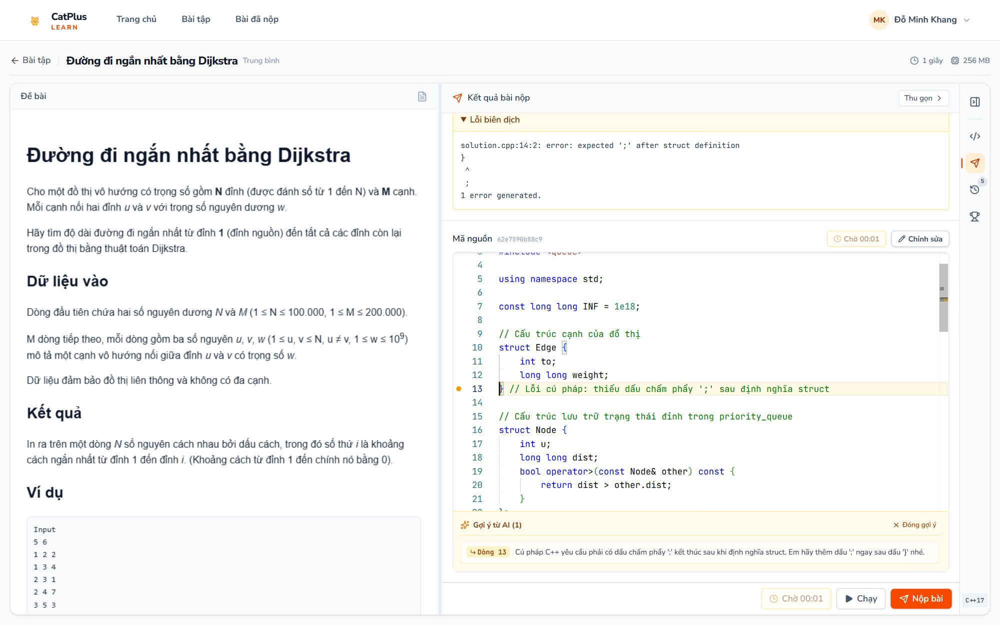

*Hình 3.15. Gợi ý thật của Gemini cho phiên bản CE bài Dijkstra: phát hiện chính xác lỗi thiếu dấu chấm phẩy sau định nghĩa struct và hướng dẫn cú pháp C++.*

2. **Trường hợp Vượt quá giới hạn thời gian (TLE - Time Limit Exceeded):**
Thuật toán Dijkstra sử dụng hàng đợi thông thường `std::queue` (FIFO) thay vì hàng đợi ưu tiên `std::priority_queue` (min-heap) tại dòng 34, đồng thời tại dòng 40 không có bước kiểm tra bỏ qua các trạng thái khoảng cách đã lỗi thời (`if (d > dist[u]) continue;`), dẫn đến việc các đỉnh bị đẩy vào hàng đợi và cập nhật lặp lại nhiều lần, làm thời gian chạy vượt quá 1 giây trên đồ thị $100\,000$ đỉnh. Gemini tạo 2 bình luận định hướng chuẩn xác: bình luận tại dòng 34 chỉ ra việc dùng queue FIFO khiến thuật toán không luôn chọn đỉnh có khoảng cách nhỏ nhất và gợi ý đổi sang `priority_queue`; bình luận tại dòng 40 hướng dẫn bổ sung điều kiện kiểm tra để bỏ qua trạng thái dư thừa, giúp tối ưu thời gian mà không viết sẵn code hoàn chỉnh cho học viên.

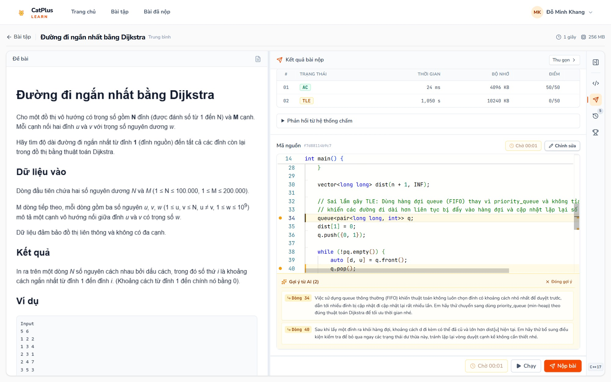

*Hình 3.16. Gợi ý thật của Gemini cho phiên bản TLE bài Dijkstra: phân tích nguyên nhân thời gian chạy do dùng sai hàng đợi và thiếu điều kiện bỏ qua trạng thái cũ.*

3. **Trường hợp Vượt quá giới hạn bộ nhớ (MLE - Memory Limit Exceeded):**
Chương trình khởi tạo bảng ma trận khoảng cách 2 chiều kích thước $(N + 1) \times (N + 1)$ kiểu `long long` tại dòng 23 (`vector<vector<long long>> all_pairs_dist(n + 1)`). Với $N = 100\,000$, ma trận này tiêu tốn khoảng $80\text{ GB}$ bộ nhớ RAM, vượt xa giới hạn $256\text{ MiB}$ của đề bài. Gemini gắn 2 bình luận: tại dòng 23 cảnh báo việc khai báo mảng 2 chiều tiêu tốn hàng chục GB bộ nhớ và nhắc nhở đề bài chỉ yêu cầu tìm đường đi từ đỉnh 1 nên chỉ cần mảng 1 chiều; tại dòng 35 nhắc học viên không cần duy trì ma trận kề vì danh sách kề `adj` đã đủ biểu diễn đồ thị.

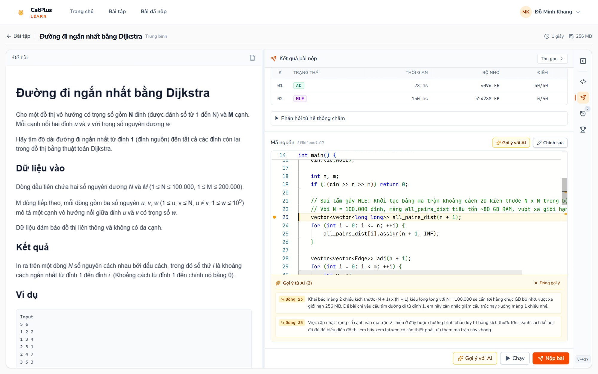

*Hình 3.17. Gợi ý thật của Gemini cho phiên bản MLE bài Dijkstra: định hướng chuyển đổi từ ma trận kề N×N sang danh sách kề để tối ưu bộ nhớ.*

4. **Trường hợp Lỗi thực thi (RTE - Runtime Error):**
Đồ thị đánh số đỉnh 1-based (từ 1 đến $N$), nhưng mảng danh sách kề lại chỉ khởi tạo $n$ phần tử (`vector<vector<Edge>> adj(n)` tại dòng 24, chỉ số từ 0 đến $n - 1$), kết hợp sử dụng phương thức truy cập `.at(u)` tại dòng 29. Khi đỉnh $u = N$, phương thức `.at(u)` ném ngoại lệ `std::out_of_range` làm chương trình dừng bất thường. Gemini đưa ra gợi ý tại dòng 24 nhắc học viên kiểm tra lại kích thước cấp phát vector cho đỉnh $N$, và tại dòng 29 giải thích cơ chế ném ngoại lệ dừng chương trình của hàm `.at()` khi chỉ số vượt ngoài phạm vi mảng.

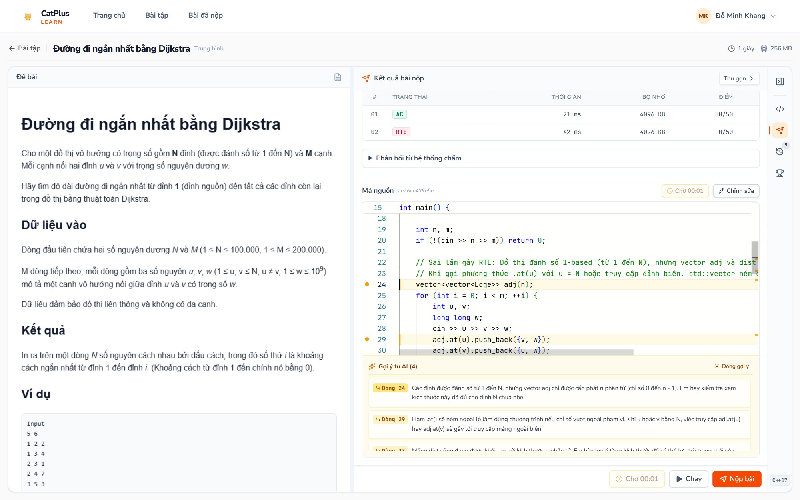

*Hình 3.18. Gợi ý thật của Gemini cho phiên bản RTE bài Dijkstra: chỉ ra ngoại lệ out_of_range khi truy cập đỉnh 1..N trên vector kích thước n qua phương thức .at().*

5. **Trường hợp Vượt quá giới hạn dữ liệu xuất (OLE - Output Limit Exceeded):**
Học viên để quên các câu lệnh in debug chi tiết (`cout << "[DEBUG] ..."` tại dòng 44 và dòng 50) bên trong các vòng lặp duyệt đỉnh và cạnh của thuật toán Dijkstra. Với đồ thị lên đến $200\,000$ cạnh, các câu lệnh này in ra hàng trăm nghìn dòng dữ liệu, làm tràn giới hạn dữ liệu xuất cho phép của hệ thống chấm. Gemini nhận diện chính xác lỗi OLE, đặt bình luận tại dòng 44 và dòng 50 giải thích việc in lặp lại với mỗi cạnh kề sẽ tạo ra lượng ký tự khổng lồ gửi về máy chấm và nhắc nhở học viên loại bỏ các lệnh in thông tin debug trước khi nộp bài.

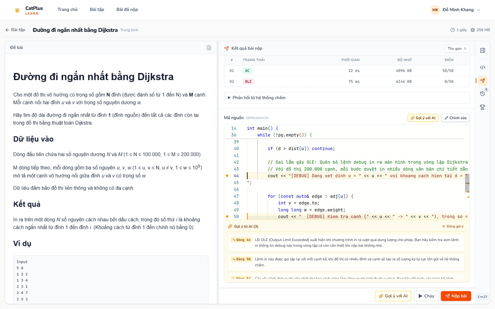

*Hình 3.19. Gợi ý thật của Gemini cho phiên bản OLE bài Dijkstra: nhắc nhở loại bỏ lệnh in debug trong vòng lặp thuật toán làm tràn giới hạn dữ liệu xuất.*

##### **3.13.3.4 Đánh giá hiện trạng chức năng**

Vì vậy, trạng thái chính xác hiện tại của chức năng là:

- **Đã hoàn thành phần triển khai trong CatPlus:** Luồng từ giao diện học viên, quản lý quyền, giới hạn thời gian chờ mười phút, chuẩn bị ngữ cảnh và xử lý dữ liệu phản hồi có cấu trúc đã hoạt động theo thiết kế;
- **Đã đạt các kiểm thử tự động và kiểm tra tính toàn vẹn:** 102 kiểm thử phía máy chủ (backend) dành riêng cho chức năng AI đã đạt, 9 kiểm thử giao diện (frontend) đã đạt; kiểm tra kiểu TypeScript, cấu hình Compose và đóng gói sản phẩm đều hoàn tất thành công;
- **Đã hoàn thiện cấu hình hạ tầng:** Cấu hình đường mạng đi ra ngoài cho dịch vụ OJ, chuỗi thời gian chờ có thứ bậc phân tầng (Gemini 62s < Gunicorn 70s < Nginx 80s < Redis lock 90s) và cơ chế chịu lỗi failover sticky với 2 khóa API;
- **Đã hoàn tất kiểm chứng đầu cuối thành công bằng phản hồi Gemini thật:** Cả các trường hợp cơ bản (code hiện tại, phiên bản WA) lẫn các trường hợp lỗi thuật toán phức tạp trên bài toán Dijkstra (CE, TLE, MLE, RTE, OLE) đều nhận được gợi ý sư phạm, gắn đúng dòng code và hiển thị trên giao diện;
- **Chức năng đã được bật trong cấu hình hệ thống:** Sẵn sàng đưa vào vận hành thử nghiệm theo quy trình kiểm soát.

#### **3.13.4 Ảnh chụp xác minh**

Các ảnh được đặt trực tiếp tại bước nghiệp vụ tương ứng:

1. **Hình 3.1:** Trình soạn thảo và vị trí nút Gợi ý với AI;
2. **Hình 3.2:** Gợi ý thật của Gemini cho code hiện tại;
3. **Hình 3.3:** Lịch sử gồm các kết quả chấm cần xử lý;
4. **Hình 3.4:** Phiên bản WA và nút phân tích đúng phiên bản;
5. **Hình 3.5:** Gợi ý thật của Gemini cho phiên bản WA;
6. **Hình 3.6:** Phiên bản TLE;
7. **Hình 3.7:** Phiên bản MLE;
8. **Hình 3.8:** Phiên bản RTE;
9. **Hình 3.9:** Phiên bản CE và thông báo biên dịch;
10. **Hình 3.10:** Phiên bản gặp lỗi hệ thống chấm;
11. **Hình 3.11:** Phiên bản đang chờ kết quả chấm;
12. **Hình 3.12:** Phiên bản đã AC;
13. **Hình 3.13:** Thông báo đồng ý trước lần đầu sử dụng;
14. **Hình 3.14:** Cách giao diện xử lý khi yêu cầu AI không hoàn thành;
15. **Hình 3.15:** Gợi ý thật của Gemini cho phiên bản CE bài Dijkstra (thiếu dấu chấm phẩy sau struct);
16. **Hình 3.16:** Gợi ý thật của Gemini cho phiên bản TLE bài Dijkstra (dùng sai hàng đợi và không bỏ trạng thái cũ);
17. **Hình 3.17:** Gợi ý thật của Gemini cho phiên bản MLE bài Dijkstra (dùng ma trận kề N×N long long);
18. **Hình 3.18:** Gợi ý thật của Gemini cho phiên bản RTE bài Dijkstra (truy cập đỉnh 1..N trên vector kích thước n qua .at());
19. **Hình 3.19:** Gợi ý thật của Gemini cho phiên bản OLE bài Dijkstra (in debug trong vòng lặp làm tràn dữ liệu xuất).

Bài tập, mã nguồn và các trạng thái kết quả chấm trong bộ ảnh là dữ liệu kiểm chứng được thiết lập có kiểm soát (controlled evidence fixtures) tại môi trường phát triển và kiểm thử nhằm minh họa đầy đủ các tình huống nghiệp vụ thực tế. Các kết quả chấm trong bộ ảnh không đại diện cho việc máy chấm DMOJ đã thực hiện những lượt chấm chính thức tương ứng. Tuy nhiên, toàn bộ phản hồi từ Gemini API trong Hình 3.2, Hình 3.5 và nhóm Hình 3.15 đến Hình 3.19 (được thử nghiệm trên bài toán thuật toán đồ thị Dijkstra với các tình huống lỗi CE, TLE, MLE, RTE, OLE) đều là các phản hồi thật do mô hình `gemini-3.8-flash` xử lý và được giao diện người dùng CatPlus tiếp nhận, gắn vào đúng dòng code và hiển thị theo thời gian thực.

## **4. Chú thích từ viết tắt và thuật ngữ tiếng Anh**

Phần này giải thích các từ viết tắt và thuật ngữ tiếng Anh được sử dụng trong tài liệu hoặc thường gặp khi làm việc với Polygon, hệ thống chấm bài và chức năng AI. Các tên tiếng Anh được giữ nguyên trong những trường hợp giao diện hoặc hệ thống nguồn sử dụng trực tiếp các tên này.

### **4.1 Thuật ngữ thường gặp trên Polygon**

| Thuật ngữ | Tên đầy đủ hoặc cách gọi | Ý nghĩa |
| --- | --- | --- |
| Polygon | Polygon | Nền tảng dùng để tạo, quản lý và đóng gói bài lập trình trước khi đưa sang CatPlus. |
| Problem | Bài lập trình | Một bài yêu cầu học viên đọc đề, viết chương trình và submit để chấm. |
| Problem ID | Mã Problem | Mã dùng để nhận diện duy nhất một Problem trên Polygon hoặc trong hệ thống. |
| Problem Set | Bộ bài tập | Một nhóm gồm nhiều Problem được sắp xếp để giao cho học viên. Đây là khái niệm tổ chức nội dung của CatPlus, không phải tên một thành phần đóng gói của Polygon. |
| Statement | Đề bài | Nội dung mô tả yêu cầu, dữ liệu vào, dữ liệu ra, giới hạn và ví dụ của Problem. |
| Input | Dữ liệu vào | Dữ liệu chương trình của học viên nhận khi chạy. |
| Output | Dữ liệu ra | Kết quả chương trình của học viên phải in ra. |
| Test hoặc Test case | Bộ dữ liệu kiểm tra | Một trường hợp gồm dữ liệu vào và thông tin cần thiết để kiểm tra kết quả chương trình. |
| Testset | Nhóm test | Một nhóm các test được tổ chức và có thể áp dụng cách tính điểm hoặc điều kiện chấm riêng. |
| Sample | Ví dụ | Test mẫu được công khai trong statement để người học hiểu cách xử lý dữ liệu. |
| Package | Gói bài | Tệp do Polygon tạo ra, chứa các thành phần cần thiết để chuyển Problem sang hệ thống khác. |
| Standard package | Gói tiêu chuẩn | Gói cơ bản của Problem, có thể chứa nguồn tạo test và các thành phần mô tả nhưng chưa chắc đã chứa đầy đủ test được tạo sẵn để chấm ngay. |
| Full package | Gói đầy đủ | Gói chứa đầy đủ các thành phần đã được chuẩn bị để hệ thống chấm có thể sử dụng. |
| Linux Full package | Gói đầy đủ cho Linux | Full package được Polygon tạo cho môi trường Linux và được CatPlus ưu tiên sử dụng để chuẩn bị dữ liệu chấm. |
| Checker | Chương trình kiểm tra kết quả | Thành phần so sánh output của học viên với kết quả mong đợi và quyết định bài làm có đúng hay không. |
| Validator | Chương trình kiểm tra dữ liệu vào | Thành phần xác nhận test tuân thủ đúng định dạng và giới hạn được quy định trong statement. |
| Generator | Chương trình tạo test | Chương trình sinh dữ liệu kiểm tra theo quy tắc của người ra đề. |
| Interactor | Chương trình tương tác | Thành phần trao đổi dữ liệu trực tiếp với chương trình của học viên trong bài tương tác. |
| Solution | Lời giải hoặc chương trình lời giải | Chương trình được người ra đề đưa lên Polygon để kiểm tra Problem. |
| Model solution | Lời giải chuẩn | Chương trình chuẩn được dùng để tạo hoặc xác nhận kết quả đúng. Nội dung này không được cung cấp cho học viên. |
| Working copy | Bản đang chỉnh sửa | Trạng thái hiện tại của Problem trên Polygon, có thể chứa thay đổi chưa được xác nhận chính thức. |
| Commit | Xác nhận phiên bản | Thao tác ghi nhận các thay đổi của Working copy thành một phiên bản chính thức trên Polygon. |
| Committed revision | Phiên bản đã được xác nhận | Phiên bản Problem đã được commit và có thể được dùng làm mốc để tạo package. |
| Revision | Phiên bản | Số hoặc mã đại diện cho một lần thay đổi của Problem trên Polygon. |
| Build | Tạo gói | Quá trình Polygon xử lý các thành phần của Problem để tạo package. |
| Metadata | Thông tin mô tả | Các thông tin như tên bài, thời gian chạy, bộ nhớ, ngôn ngữ và mã phiên bản. |
| Checksum | Mã kiểm tra dữ liệu | Giá trị dùng để xác nhận package tải về không bị thay đổi hoặc hư hỏng. |
| READY | Sẵn sàng | Package đã được Polygon tạo thành công và có thể tải về. |
| PENDING | Đang chờ | Yêu cầu tạo package đã được tiếp nhận nhưng chưa bắt đầu hoặc chưa hoàn tất. |
| RUNNING | Đang xử lý | Polygon đang thực hiện quá trình tạo package. |
| FAILED | Thất bại | Quá trình tạo package không thành công và cần kiểm tra lại Problem trên Polygon. |

### **4.2 Từ viết tắt và thuật ngữ chấm bài**

| Từ viết tắt hoặc thuật ngữ | Tên đầy đủ | Ý nghĩa |
| --- | --- | --- |
| OJ | Online Judge | Hệ thống tự động biên dịch, chạy và đánh giá code của học viên. |
| Judge | Chấm bài | Quá trình chạy code bằng test và xác định kết quả. |
| Submit hoặc Submission | Nộp bài hoặc bài đã nộp | Việc gửi code chính thức để hệ thống chấm. |
| AC | Accepted | Code đã vượt qua toàn bộ test và được chấp nhận là đúng. |
| WA | Wrong Answer | Chương trình chạy được nhưng tạo ra kết quả sai ở ít nhất một test. |
| TLE | Time Limit Exceeded | Chương trình chạy lâu hơn giới hạn thời gian cho phép. |
| MLE | Memory Limit Exceeded | Chương trình sử dụng nhiều bộ nhớ hơn giới hạn cho phép. |
| RTE hoặc RE | Runtime Error | Chương trình biên dịch được nhưng dừng bất thường khi chạy. Trong tài liệu sử dụng RTE; trạng thái nội bộ của project có thể được ghi là RE. |
| CE | Compilation Error | Code không thể biên dịch thành chương trình để chạy. |
| QUEUED | Đang chờ | Bài submit đã được tiếp nhận và đang chờ chuyển tới hệ thống chấm. |
| DISPATCHING | Đang chuyển đi chấm | Hệ thống đang gửi bài submit tới bộ phận chấm bài. |
| RUNNING | Đang chấm | Code đang được biên dịch hoặc chạy với các test. |
| SYSTEM_ERROR | Lỗi hệ thống | Quá trình chấm gặp lỗi từ hạ tầng hoặc dịch vụ chấm, chưa thể kết luận code đúng hay sai. |
| CANCELLED | Đã hủy | Yêu cầu chấm đã bị hủy và không có kết quả chuyên môn cho bài làm. |
| Test ẩn | Hidden test | Test không được công khai cho học viên, dùng để đánh giá bài làm chính thức. |
| Chạy thử | Run | Việc chạy code để kiểm tra trước khi submit; kết quả không được tính là một lần nộp bài chính thức. |
| CPP17 hoặc C++17 | C++ phiên bản 2017 | Ngôn ngữ và tiêu chuẩn biên dịch đang được hệ thống hỗ trợ cho bài làm. |

### **4.3 Thuật ngữ liên quan đến chức năng AI**

| Thuật ngữ | Ý nghĩa |
| --- | --- |
| AI | Trí tuệ nhân tạo; trong chức năng này được dùng để tạo gợi ý định hướng dựa trên code và ngữ cảnh bài tập. |
| Gemini | Dịch vụ AI của Google được CatPlus gọi để tạo nội dung gợi ý. |
| API | Cách các hệ thống phần mềm gửi yêu cầu và nhận kết quả với nhau. Trình duyệt gửi yêu cầu tới CatPlus; máy chủ CatPlus mới gọi Gemini API. |
| Prompt hoặc bộ yêu cầu AI | Nội dung chỉ dẫn cố định quy định AI được phân tích điều gì, không được cung cấp điều gì và phải trả kết quả theo dạng nào. |
| Cache hoặc bộ nhớ đệm | Nơi giữ dữ liệu tạm thời phục vụ giới hạn lượt và trạng thái đang xử lý; không dùng để lưu code hoặc nội dung gợi ý. |
| Redis | Thành phần được sử dụng làm bộ nhớ đệm để quản lý thời gian chờ và ngăn nhiều yêu cầu AI đồng thời. |
| Docker | Công cụ đóng gói và chạy các dịch vụ của dự án trong những môi trường tách biệt. |
| TypeScript | Ngôn ngữ được sử dụng ở phần giao diện; bước kiểm tra TypeScript giúp phát hiện lỗi về kiểu dữ liệu trước khi chạy. |
| HTTP 503 | Dịch vụ bên ngoài tạm thời không thể xử lý yêu cầu. |
| HTTP 504 | Yêu cầu tới dịch vụ bên ngoài không hoàn thành trong thời gian chờ. |

## **5. So sánh CatPlus với Moodle và Canvas**

### **5.1 Mục đích so sánh**

Moodle và Canvas là các hệ thống quản lý học tập tổng quát, được xây dựng để phục vụ nhiều loại trường học, tổ chức đào tạo và môn học khác nhau. CatPlus được xây dựng cho phạm vi hẹp hơn là hoạt động của trung tâm đào tạo lập trình.

Moodle và Canvas lấy khóa học làm không gian tổ chức chính. Giáo viên đưa học liệu và hoạt động vào khóa học, học viên được ghi danh, thực hiện hoạt động và nhận kết quả. CatPlus lấy quá trình học thêm của từng học viên làm trung tâm, trong đó học viên được xếp vào lớp một kèm một hoặc lớp nhóm nhỏ, có gia sư phụ trách, lịch học, từng buổi học, nhận xét riêng và tiến độ làm bài theo thời gian.

Việc so sánh không nhằm khẳng định CatPlus có nhiều chức năng hơn Moodle hoặc Canvas. Mục đích chính là xác định những nghiệp vụ CatPlus có thể giải quyết phù hợp hơn cho trung tâm lập trình và làm rõ lý do cần xây dựng một hệ thống chuyên biệt.

**Kết luận trọng tâm:** Moodle và Canvas quản lý hoạt động học tập nói chung. CatPlus liên kết hoạt động vận hành của trung tâm với toàn bộ quá trình học viên giải bài lập trình.

Giá trị khác biệt cốt lõi của CatPlus không nằm ở một chức năng riêng lẻ. Giá trị nằm ở mô hình nghiệp vụ xuyên suốt liên kết học viên, lớp, buổi học, gia sư, bài được giao, từng phiên bản code, kết quả chấm và quá trình hỗ trợ học viên trong cùng một hệ thống.

Vì vậy, phạm vi CatPlus có cơ sở để tạo lợi thế là trung tâm đào tạo lập trình, không phải toàn bộ thị trường quản lý học tập. Nếu mục tiêu là quản lý nhiều môn học, kho học liệu lớn, diễn đàn, sổ điểm phức tạp hoặc khung năng lực, Moodle và Canvas phù hợp hơn.

### **5.2 So sánh tổng quan**

Việc so sánh được thực hiện theo công việc thực tế của người dùng thay vì chỉ kiểm tra từng hệ thống có hay không có một chức năng.

| Nghiệp vụ | CatPlus | Moodle | Canvas | Kết luận theo phạm vi thiết kế |
| --- | --- | --- | --- | --- |
| Đơn vị tổ chức chính | Học viên trong mối quan hệ với lớp học thêm, gia sư, lịch học và từng buổi học | Khóa học chứa học liệu và hoạt động dành cho người được ghi danh | Khóa học và mô-đun chứa nội dung, bài tập và hoạt động | CatPlus được thiết kế cho mô hình học thêm và gia sư; Moodle và Canvas được thiết kế quanh khóa học |
| Cá nhân hóa quá trình học | Có lớp một kèm một, lớp nhóm nhỏ, mục tiêu của học viên, gia sư phụ trách, nhận xét từng buổi và tiến độ code | Có nhóm, điều kiện truy cập, khung năng lực và kế hoạch học tập cho từng người | Có thể giao hoạt động cho từng học viên, nhóm hoặc phân nhóm trong khóa học | Không phải lợi thế độc quyền; CatPlus khác ở việc đặt cá nhân hóa trong ngữ cảnh học thêm và quá trình làm bài lập trình |
| Quản lý nhiều môn học và nhiều loại học liệu | Tập trung chủ yếu vào đào tạo lập trình | Hỗ trợ phong phú và có khả năng tùy chỉnh cao | Hỗ trợ tốt việc tổ chức khóa học, mô-đun, bài tập và thảo luận | Moodle và Canvas có lợi thế rõ ràng |
| Tổ chức lớp, lịch học và buổi học tại trung tâm | Lớp, gia sư, lịch định kỳ, buổi học, điểm danh và báo cáo buổi học nằm trong cùng một mô hình | Có thể sử dụng chức năng và phần bổ sung về nhóm, lịch, điểm danh hoặc lịch hẹn | Có thể sử dụng khóa học, lịch và công cụ điểm danh | CatPlus liên kết trực tiếp buổi học với hoạt động làm bài lập trình |
| Đưa Problem từ Polygon đến học viên | Có luồng đồng bộ, kiểm tra dữ liệu, tạo Problem Set và giao cho lớp | Cần phần tích hợp Polygon riêng rồi ánh xạ dữ liệu sang hoạt động lập trình | Cần công cụ ngoài hoặc phần tích hợp riêng | CatPlus đã có luồng chuyên biệt này |
| Học viên viết, chạy thử và submit | Các thao tác nằm trong cùng không gian làm bài | Có thể thực hiện bằng CodeRunner hoặc Virtual Programming Lab | Có thể thực hiện qua công cụ lập trình được kết nối | CatPlus có luồng mặc định phù hợp sẵn; Moodle và Canvas có thể đạt được khi bổ sung công cụ |
| Chấm code tự động | Là chức năng cốt lõi và gắn với tiến độ Problem | CodeRunner và Virtual Programming Lab có thể chạy và chấm code | Có thể kết nối công cụ chấm code và nhận lại kết quả | Không phải lợi thế riêng nếu chỉ xét khả năng chấm code |
| Theo dõi quá trình sửa bài | Từng phiên bản code và kết quả chấm được đặt trong ngữ cảnh học viên, lớp, Problem và bài được giao | Có thể lưu nhiều lần làm qua công cụ lập trình, nhưng cần tổ chức thêm để gắn với nghiệp vụ trung tâm | Có thể lưu nhiều lần nộp qua hoạt động và công cụ tích hợp, nhưng cần bổ sung ngữ cảnh lập trình | CatPlus đã có ngữ cảnh chuyên biệt để theo dõi quá trình từ lỗi đến AC |
| Gia sư hỗ trợ học viên | Gia sư xem tiến độ, số lần submit, code và kết quả của học viên thuộc lớp; bản code hỗ trợ không làm thay đổi bài của học viên | Có thể thực hiện bằng dữ liệu khóa học và phần bổ sung lập trình | Có thể thực hiện qua dữ liệu khóa học và công cụ ngoài | CatPlus đã có quy trình hỗ trợ lập trình riêng cho gia sư |
| Kiểm soát việc xem code đúng của học viên khác | Chỉ mở code đúng sau khi người xem đã AC cùng Problem | Cần cấu hình hoặc phát triển theo chính sách của đơn vị | Cần cấu hình hoặc phát triển theo chính sách của đơn vị | CatPlus đã hiện thực hóa chính sách này |
| Sổ điểm, khung năng lực và đánh giá tổng quát | Chưa phải trọng tâm | Hoàn thiện và có khả năng tùy chỉnh sâu | Hoàn thiện, hỗ trợ tiêu chí đánh giá và kết quả học tập | Moodle và Canvas có lợi thế rõ ràng |
| Diễn đàn, cộng tác và ứng dụng di động | Chưa phải ưu thế hiện tại | Có nhiều hoạt động cộng tác và ứng dụng chính thức | Có thảo luận và ứng dụng cho nhiều nhóm người dùng | Moodle và Canvas có lợi thế rõ ràng |
| Đưa hệ thống vào sử dụng cho trung tâm lập trình | Các thành phần chuyên biệt đã được tích hợp thành một luồng sử dụng | Có thể đạt năng lực tương tự sau khi lựa chọn, cấu hình và kết nối các thành phần cần thiết | Có thể đạt năng lực tương tự thông qua công cụ ngoài và phần tích hợp | CatPlus được thiết kế để giảm công việc tích hợp; mức giảm thực tế cần được đo lường |

#### **5.2.1 Khoảng trống giữa các nhóm giải pháp hiện có**

Việc đánh giá được thực hiện dựa trên tài liệu công khai của một số sản phẩm tiêu biểu tại thời điểm khảo sát tháng 10 năm 2026, không dựa trên giả định về một đối thủ tương lai có thể làm mọi chức năng của CatPlus tốt hơn.

Thị trường hiện có nhiều sản phẩm mạnh, nhưng các sản phẩm được khảo sát chủ yếu tập trung vào từng nhóm bài toán riêng:

| Nhóm giải pháp | Sản phẩm tiêu biểu được khảo sát | Điểm mạnh chính | Phần chưa được ghi nhận như một quy trình mặc định |
| --- | --- | --- | --- |
| Hệ thống quản lý học tập tổng quát | Moodle, Canvas | Khóa học, học liệu, bài tập, sổ điểm, thảo luận, khung năng lực và khả năng tích hợp | Chuỗi vận hành trung tâm gia sư lập trình nối từng buổi học với từng phiên bản code và kết quả chấm |
| Công cụ lập trình trong hệ thống quản lý học tập | CodeRunner, Virtual Programming Lab, CodeGrade | Viết code, chạy, chấm tự động, phản hồi và chuyển điểm về khóa học | Lịch định kỳ, dời hoặc bù buổi, điểm danh, nhận xét từng buổi và lịch sử chuyển lớp được nối với quá trình sửa code |
| Nền tảng đào tạo lập trình | Codio | Môi trường viết code, chấm tự động, nội dung theo khóa học, theo dõi học viên và hỗ trợ người dạy | Mô hình vận hành trung tâm học thêm với lớp nhỏ, lịch định kỳ, từng buổi học, điểm danh, chốt buổi và nhận xét được nối với Polygon và lịch sử submit |
| Hệ thống chấm bài và thi lập trình | DMOJ | Problem, contest, submission, nhiều ngôn ngữ, hệ thống chấm và bảng xếp hạng | Nghiệp vụ gia sư theo từng buổi học, điểm danh, báo cáo buổi học và lộ trình học thêm |
| Công cụ chuẩn bị Problem | Polygon | Statement, test, checker, lời giải chuẩn, kiểm tra dữ liệu và package | Quản lý học viên, lớp, gia sư, buổi học và tiến độ học tập |
| Phần mềm quản lý trung tâm hoặc gia sư | Teachworks, TutorBird, TutorCruncher, Classcard, Oases | Học viên, gia sư, lịch, lớp cá nhân hoặc nhóm, điểm danh, ghi chú, hóa đơn và thanh toán | Hệ thống chấm code tự động, quản trị Problem kiểu Polygon và luồng nộp code, biên dịch, chạy test, chấm tự động |

Trong phạm vi các sản phẩm và tài liệu công khai được khảo sát, chưa ghi nhận một sản phẩm cung cấp sẵn toàn bộ chuỗi sau như mô hình nghiệp vụ mặc định:

```text
Học viên
    ↓
Lớp học thêm và gia sư phụ trách
    ↓
Lịch định kỳ và từng buổi học
    ↓
Điểm danh và nhận xét riêng
    ↓
Problem từ Polygon và bài được giao
    ↓
Từng phiên bản code và kết quả chấm
    ↓
Gia sư theo dõi và điều chỉnh cách hỗ trợ
```

Kết luận này chỉ áp dụng cho nhóm sản phẩm và phạm vi tài liệu đã khảo sát. Kết luận không khẳng định tuyệt đối rằng không có bất kỳ sản phẩm nào khác trên toàn thị trường, đồng thời không loại trừ tính năng riêng, phiên bản thử nghiệm hoặc phần tùy chỉnh chưa được công bố.

#### **5.2.2 Ý nghĩa của khoảng trống đối với CatPlus**

Giải pháp thay thế gần nhất cho CatPlus hiện không phải một sản phẩm đơn lẻ mà là sự kết hợp của nhiều nhóm công cụ, chẳng hạn:

```text
Moodle hoặc Canvas
+ Công cụ dạy và chấm code
+ Máy chủ thực thi code
+ Polygon hoặc công cụ chuẩn bị Problem
+ Phần mềm quản lý trung tâm
+ Phần tổng hợp dữ liệu dành cho gia sư
```

CatPlus giải quyết khoảng trống này bằng cách đưa dữ liệu vận hành trung tâm và dữ liệu học lập trình vào cùng một mô hình nghiệp vụ. Đây là đóng góp hiện hữu của sản phẩm, không phụ thuộc vào việc một đối thủ trong tương lai có thể sao chép các chức năng tương tự hay không.

Một sản phẩm không cần phải là thứ không thể sao chép mới có lý do để được xây dựng. Lý do xây dựng CatPlus là trên nhóm giải pháp đã khảo sát, bài toán của trung tâm gia sư lập trình vẫn đang phải được giải quyết bằng nhiều hệ thống hoặc nhiều phần tích hợp khác nhau.

#### **5.2.3 Nguồn đối chiếu chính**

Các nhận định trong phần khảo sát được đối chiếu từ trang giới thiệu, tài liệu chức năng hoặc kho mã chính thức của các sản phẩm:

- [Moodle Courses](https://docs.moodle.org/502/en/Courses), [Moodle Learning Plans](https://docs.moodle.org/502/en/learning_plans) và [Moodle Open Source](https://moodle.com/about/open-source/);
- [Canvas Modules](https://developerdocs.instructure.com/services/canvas/resources/modules) và [Canvas External Tools](https://developerdocs.instructure.com/services/canvas/external-tools/lti/file.tools_intro);
- [CodeRunner](https://moodle.org/plugins/qtype_coderunner) và [Virtual Programming Lab](https://vpl.dis.ulpgc.es/index.php/en/about/what-is-vpl);
- [CodeGrade](https://www.codegrade.com/solutions/learning-and-grading-in-one-place) và [Codio](https://www.codio.com/);
- [DMOJ](https://github.com/DMOJ/online-judge) và [Polygon](https://polygon.codeforces.com/);
- [Teachworks](https://www.teachworks.com/tutoring-management-software), [TutorBird](https://www.tutorbird.com/uk/), [TutorCruncher](https://tutorcruncher.com/features), [Classcard](https://www.classcardapp.com/) và [Oases](https://oasesonline.com/).

### **5.3 Năng lực của Moodle và Canvas**

Moodle và Canvas mạnh hơn CatPlus về quản lý học tập tổng quát. Hai hệ thống đã có hệ thống khóa học, học liệu, bài tập, sổ điểm, thảo luận, phân quyền, báo cáo, ứng dụng di động và khả năng tích hợp với công cụ bên ngoài.

Moodle và Canvas cũng có khả năng cá nhân hóa trong phạm vi khóa học. Moodle có nhóm, điều kiện truy cập, khung năng lực và kế hoạch học tập. Canvas có thể giao hoạt động cho từng học viên hoặc nhóm và tổ chức nội dung theo kết quả trước đó.

Khả năng viết và chấm code không phải lợi thế độc quyền của CatPlus. Moodle có thể sử dụng CodeRunner hoặc Virtual Programming Lab. Canvas có thể kết nối công cụ lập trình bên ngoài và nhận lại kết quả. Các nền tảng như CodeGrade và Codio còn cung cấp môi trường viết code, chấm tự động, phản hồi và theo dõi học viên chuyên sâu.

Vì vậy, CatPlus không được xem là tốt hơn chỉ vì có điểm danh, lịch sử nộp bài, trình soạn thảo, chấm code, AI hoặc cá nhân hóa. Điểm khác biệt cần chứng minh là mối liên hệ giữa hoạt động gia sư theo từng buổi và bằng chứng học tập ở cấp từng phiên bản code.

### **5.4 Khả năng xây dựng giải pháp tương tự trên Moodle hoặc Canvas**

Moodle là phần mềm mã nguồn mở và có thể được sửa đổi hoặc mở rộng. Một đơn vị có thể dùng Moodle làm nền tảng, bổ sung chấm code, đồng bộ Polygon, quản lý buổi học và bảng theo dõi gia sư để tạo một sản phẩm cạnh tranh trực tiếp với CatPlus. Canvas cũng có thể đạt năng lực tương tự thông qua công cụ ngoài và phần tích hợp riêng.

Điều này cho thấy CatPlus không có lợi thế độc quyền về công nghệ. Tuy nhiên, để tạo ra quy trình tương đương, giải pháp thay thế vẫn phải hiện thực hóa các mối liên hệ và quy tắc nghiệp vụ mà CatPlus đã xây dựng, gồm lớp học thêm, lịch định kỳ, vòng đời buổi học, nhận xét từng học viên, Polygon, Problem Set, từng phiên bản code và quyền hỗ trợ của gia sư.

Mã nguồn mở giúp đơn vị phát triển không phải xây lại từ đầu các chức năng quản lý học tập tổng quát, nhưng không tự tạo ra nghiệp vụ chuyên biệt còn thiếu. Công việc vẫn bao gồm thiết kế mô hình dữ liệu, xây dựng các phần tích hợp, thống nhất quyền truy cập, bảo vệ dữ liệu chấm, kiểm thử toàn bộ chuỗi và duy trì khả năng tương thích khi từng thành phần được nâng cấp. Vì vậy, lấy Moodle làm nền tảng làm thay đổi điểm bắt đầu và chi phí phát triển, nhưng không loại bỏ bài toán mà CatPlus đang giải quyết.

Một giải pháp phát triển từ Moodle hoàn toàn có thể trở thành đối thủ mạnh nếu được đầu tư đủ tốt. Lợi thế của CatPlus vì thế không phải là đối thủ không thể làm được, mà là các quy tắc chuyên biệt đã được xác định, xây dựng và nối thành một quy trình sử dụng thống nhất ngay trong sản phẩm hiện tại.

Một đối thủ giả định có mọi chức năng của CatPlus và thực hiện mọi chức năng tốt hơn không phải là tiêu chuẩn đánh giá khoảng trống hiện tại. Nếu một sản phẩm cạnh tranh như vậy xuất hiện, việc so sánh phải được thực hiện với sản phẩm thật bằng các tiêu chí tại mục 5.10.

### **5.5 Ý nghĩa cạnh tranh đối với CatPlus**

Luận điểm cạnh tranh của CatPlus được hình thành theo chuỗi nguyên nhân và kết luận sau:

1. Trung tâm gia sư lập trình phải đồng thời quản lý học viên, lớp, gia sư, từng buổi học và quá trình giải bài bằng code;
2. Các nhóm sản phẩm được khảo sát giải quyết tốt từng phần, nhưng chưa cung cấp sẵn toàn bộ chuỗi này như một mô hình nghiệp vụ mặc định;
3. CatPlus đã hiện thực hóa mối liên hệ giữa hai phía bằng các chức năng và quy tắc có thể kiểm tra trực tiếp trong hệ thống;
4. Do đó, lợi thế hiện tại của CatPlus là mức độ phù hợp sẵn với quy trình của trung tâm gia sư lập trình, không phải số lượng chức năng, một công nghệ độc quyền hoặc giả định rằng đối thủ không thể sao chép.

Khả năng bị sao chép là rủi ro cạnh tranh, nhưng không phủ nhận giá trị của một sản phẩm đang giải quyết khoảng trống hiện có. Giải pháp thay thế gần nhất trong phạm vi khảo sát vẫn cần kết hợp nhiều nhóm công cụ hoặc xây dựng thêm các phần nghiệp vụ chuyên biệt.

Lợi thế này không tự tồn tại mãi. CatPlus phải tiếp tục chuyển lợi thế đi trước thành dữ liệu phục vụ giảng dạy, nội dung và lộ trình phù hợp, chất lượng vận hành, quy trình triển khai và bằng chứng hiệu quả thực tế.

### **5.6 Điểm khác biệt của CatPlus**

Điểm khác biệt của CatPlus không nằm ở số lượng chức năng mà nằm ở việc quy trình của trung tâm lập trình đã trở thành cấu trúc mặc định của sản phẩm. Các thành phần bên ngoài vẫn được sử dụng, nhưng đã được CatPlus tích hợp và trình bày thành một luồng thống nhất cho học viên, gia sư và quản trị viên.

#### **5.6.1 Mô hình học thêm, gia sư và lộ trình cá nhân hóa**

Moodle và Canvas thường bắt đầu từ khóa học:

```text
Khóa học
    ↓
Học liệu và hoạt động
    ↓
Học viên được ghi danh
    ↓
Bài nộp và kết quả
```

CatPlus bắt đầu từ quá trình học thực tế của học viên tại trung tâm:

```text
Học viên và mục tiêu học tập
    ↓
Lớp một kèm một hoặc lớp nhóm nhỏ
    ↓
Gia sư và lịch học định kỳ
    ↓
Từng buổi học, điểm danh và nhận xét riêng
    ↓
Problem Set được giao
    ↓
Tiến độ code và lịch sử submit
    ↓
Gia sư điều chỉnh cách hỗ trợ theo tiến độ thực tế
```

Mức độ cá nhân hóa hiện có được thể hiện qua:

- Lớp một kèm một chỉ có một học viên;
- Lớp nhóm được tổ chức với số lượng từ ba đến năm học viên;
- Học viên có mục tiêu học tập riêng;
- Mỗi lớp có gia sư phụ trách;
- Từng học viên được điểm danh và nhận xét riêng trong mỗi buổi;
- Tiến độ được xác định từ kết quả làm từng Problem;
- Khi chuyển lớp, lịch sử buổi học và dữ liệu cũ vẫn được giữ lại.

CatPlus nhờ đó có nền tảng để điều chỉnh nội dung và cách hỗ trợ theo từng học viên. Đây là mô hình gần với hoạt động học thêm và gia sư hơn mô hình khóa học đại trà.

Tuy nhiên, chức năng cá nhân hóa hiện tại chưa phải một hệ thống tự động tạo lộ trình riêng. Bài tập vẫn chủ yếu được giao theo lớp hoặc buổi học. Hệ thống chưa tự đề xuất Problem tiếp theo, chưa tự thay đổi độ khó và chưa tự tạo một lộ trình khác nhau cho từng học viên trong cùng lớp. Vì vậy, tài liệu chỉ xác định đây là nền tảng cho lộ trình cá nhân hóa, không mô tả như một chức năng đã hoàn thiện.

#### **5.6.2 Quy trình chuẩn bị và giao bài**

```text
Problem trên Polygon
        ↓
Đồng bộ statement, test, checker, package và giới hạn
        ↓
Kiểm tra tình trạng sẵn sàng
        ↓
Đưa Problem vào Problem Set
        ↓
Giao Problem Set cho lớp hoặc buổi học
```

Người vận hành không phải nhập lại riêng đề bài, dữ liệu chấm và giới hạn chạy vào nhiều công cụ. Khi bài tập được giao, hệ thống giữ lại tên Problem Set và danh sách Problem tại thời điểm giao để nội dung cũ không tự thay đổi theo lần chỉnh sửa sau.

#### **5.6.3 Quy trình làm bài của học viên**

```text
Nhận bài theo lớp
        ↓
Đọc statement và viết code
        ↓
Yêu cầu gợi ý bước tiếp theo khi cần
        ↓
Chạy thử hoặc submit
        ↓
Nhận kết quả chấm
        ↓
Mở lại từng phiên bản chưa đạt
        ↓
Yêu cầu gợi ý đúng theo loại lỗi và tiếp tục sửa bài
```

Học viên không phải chuyển sang một hệ thống khác để đọc đề, viết code, chạy thử, submit, xem kết quả và yêu cầu hỗ trợ định hướng. Khi yêu cầu gợi ý tại trình soạn thảo, hệ thống chỉ phân tích code hiện tại. Khi yêu cầu gợi ý cho một lỗi, học viên phải mở đúng phiên bản trong lịch sử và hệ thống tự sử dụng kết quả chấm thật của phiên bản đó.

Tiến độ của bài được giao được xác định từ kết quả thật của các Problem, không chỉ từ việc học viên đã mở hoặc đã nộp bài. Gợi ý AI không thay đổi kết quả và không được xem là bằng chứng hoàn thành bài.

#### **5.6.4 Quy trình hỗ trợ của gia sư**

Gia sư có thể đi từ lớp đang phụ trách đến Problem Set, từng học viên, lần submit mới nhất, số lần submit, code và kết quả chấm. Gia sư có thể lưu và chạy thử một bản code hỗ trợ riêng mà không thay đổi code, kết quả hoặc lịch sử của học viên và không submit thay học viên.

Điểm này giúp việc hỗ trợ giữ nguyên trách nhiệm làm bài của học viên, đồng thời cho gia sư đủ ngữ cảnh để tìm hiểu vấn đề.

#### **5.6.5 Dữ liệu xuyên suốt**

CatPlus liên kết dữ liệu theo chuỗi:

```text
Học viên
    ↓
Lớp và thời gian tham gia lớp
    ↓
Buổi học và gia sư phụ trách
    ↓
Bài được giao
    ↓
Problem
    ↓
Từng lần submit và code tương ứng
    ↓
Kết quả chấm và quá trình đạt AC
```

Từ chuỗi dữ liệu này, gia sư có thể xác định trực tiếp:

- Học viên nào chưa bắt đầu bài được giao;
- Học viên nào đang làm nhưng chưa hoàn thành;
- Học viên đang bị kẹt ở Problem nào;
- Học viên đã submit bao nhiêu lần và kết quả thay đổi như thế nào;
- Phiên bản code nào tạo ra từng kết quả chấm;
- Học viên nào cần được ưu tiên xem bài.

Moodle và Canvas có thể được phát triển để cung cấp thông tin tương tự. Điểm khác biệt hiện có của CatPlus là mối liên hệ này đã nằm trong mô hình nghiệp vụ mặc định, thay vì phải tổng hợp từ khóa học, phần bổ sung lập trình và công cụ vận hành riêng.

#### **5.6.6 Các quy tắc nghiệp vụ đã được hiện thực hóa**

Lợi thế của CatPlus không chỉ nằm ở việc hiển thị nhiều chức năng trên cùng một giao diện. Hệ thống đã hiện thực hóa các quy tắc cụ thể của trung tâm gia sư lập trình:

- Mỗi học viên chỉ có một quan hệ lớp hiện hành tại một thời điểm, nhưng lịch sử lớp cũ vẫn được giữ khi chuyển lớp;
- Lớp một kèm một và lớp nhóm nhỏ có giới hạn học viên rõ ràng;
- Gia sư chỉ được thao tác trên lớp thuộc phạm vi được phân công;
- Lịch học kiểm tra trùng lớp và xung đột thời gian của gia sư;
- Buổi học có vòng đời lên lịch, bắt đầu, hoàn tất, hủy, dời và dạy bù;
- Khi buổi học hoàn tất, hệ thống giữ bản chụp học viên, lớp, gia sư thực tế và thời điểm hoàn tất;
- Điểm danh và nhận xét được ghi riêng cho từng học viên; các phiên bản nhận xét cũ được giữ lại;
- Bài được giao giữ lại tên Problem Set và danh sách Problem tại thời điểm giao;
- Chạy thử không được tính là submit chính thức và không làm thay đổi tiến độ;
- Test ẩn không được gửi toàn bộ về trình duyệt;
- Gợi ý AI cho code hiện tại không tự trộn kết quả của một phiên bản submit cũ;
- Gợi ý AI cho một phiên bản chưa đạt chỉ tập trung vào đúng nhóm lỗi do hệ thống chấm xác định;
- Nội dung gợi ý, prompt hoàn chỉnh và code gửi tới AI không được lưu thành lịch sử trong CatPlus;
- Gia sư có thể chạy bản code hỗ trợ riêng nhưng không thay đổi hoặc submit thay học viên;
- Học viên chỉ được xem code đúng của người khác sau khi đã AC cùng Problem.

Đây là các quy tắc nghiệp vụ đã có, không phải lợi ích giả định. Một hệ thống khác vẫn có thể phát triển những quy tắc tương tự, nhưng cần phân tích, xây dựng, kết nối và kiểm thử lại theo đúng mô hình hoạt động của trung tâm.

### **5.7 Phân loại rõ các luận điểm về CatPlus**

#### **5.7.1 Lợi thế đã có**

Lợi thế mạnh nhất hiện tại của CatPlus là chuỗi dữ liệu và thao tác đã được nối sẵn từ lớp, buổi học và Polygon đến từng phiên bản code, kết quả chấm và hoạt động hỗ trợ của gia sư.

Lợi thế này được chứng minh bằng các chức năng và quy tắc đã mô tả tại mục 5.6, không phụ thuộc vào AI, học phí, chăm sóc khách hàng hoặc khả năng tự động tạo lộ trình.

#### **5.7.2 Chức năng chưa được xem là lợi thế đã được chứng minh**

- Chức năng hỗ trợ định hướng làm bài với AI đã được triển khai và đã hoàn tất kiểm tra đầu cuối bằng Gemini thật cho code hiện tại và phiên bản WA. Các trường hợp TLE, MLE, RTE, CE và lỗi khác đã đi hết luồng giao diện nhưng chưa nhận được phản hồi Gemini thành công do dịch vụ quá tải và khóa kiểm thử chạm giới hạn sử dụng trong ngày; chức năng chưa được đưa vào hoạt động chính thức và chưa có số liệu chứng minh hiệu quả học tập;
- Hệ thống mới có nền tảng dữ liệu cho cá nhân hóa, chưa tự tạo hoặc điều chỉnh lộ trình riêng;
- Các chức năng chăm sóc khách hàng chưa hoàn thiện và chưa được triển khai;
- Các chức năng học thử và tiền chưa được đưa vào hoạt động thực tế.

Những nội dung trên phải được trình bày đúng trạng thái. Phần đã có mã nguồn và kiểm thử được ghi nhận là đã triển khai, nhưng chưa được dùng làm bằng chứng về hiệu quả hoặc ưu thế cạnh tranh cho đến khi có kết quả sử dụng thực tế.

#### **5.7.3 Giá trị cần được kiểm chứng bằng số liệu**

CatPlus được thiết kế với kỳ vọng giảm số công cụ phải chuyển qua, giảm công việc tích hợp, rút ngắn thời gian đưa Problem đến lớp và giúp gia sư tìm học viên đang bị kẹt nhanh hơn. Các giá trị này là giả thuyết kinh doanh và sử dụng, chưa phải kết quả đã được chứng minh.

Để tạo lợi thế dài hạn, CatPlus cần tiếp tục phát triển dữ liệu phục vụ giảng dạy, lộ trình nội dung, công cụ hỗ trợ quyết định cho gia sư, chất lượng hệ thống chấm, quy trình triển khai và bằng chứng về hiệu quả thực tế.

### **5.8 Ranh giới của lợi thế cạnh tranh**

Trình soạn thảo code, dịch vụ chấm bài, Polygon API, Gemini API, điểm danh, lớp học hoặc bảng xếp hạng không tạo ra lợi thế nếu đứng riêng. Các hệ thống khác đều có thể sử dụng hoặc phát triển những thành phần tương tự.

Lợi thế hiện hữu của CatPlus là mô hình kết hợp hai nhóm dữ liệu vốn thường bị tách rời:

- Dữ liệu vận hành trung tâm: học viên, lớp, gia sư, lịch, buổi học, điểm danh và nhận xét;
- Dữ liệu học lập trình: Polygon, Problem Set, bài được giao, code, submit, kết quả chấm và quá trình đạt AC.

Khả năng kết hợp này tạo ra lý do để xây dựng sản phẩm, nhưng chưa tự chứng minh rằng CatPlus rẻ hơn, nhanh hơn hoặc tốt hơn. Những kết luận về hiệu quả chỉ được đưa ra sau khi thực hiện đánh giá tại mục 5.10.

### **5.9 Phạm vi CatPlus chưa thể thay thế Moodle và Canvas**

CatPlus chưa phù hợp để thay thế Moodle hoặc Canvas trong trường hợp đơn vị cần:

- Tổ chức đồng thời nhiều loại môn học;
- Quản lý kho học liệu lớn và đa dạng;
- Sử dụng nhiều hình thức kiểm tra ngoài lập trình;
- Tổ chức diễn đàn, thảo luận và đánh giá đồng cấp;
- Quản lý sổ điểm phức tạp hoặc khung năng lực;
- Sử dụng hệ sinh thái phần bổ sung và ứng dụng di động đã hoàn thiện.

Trong các trường hợp trên, việc sử dụng Moodle, Canvas hoặc tích hợp CatPlus như một công cụ lập trình bổ sung có thể phù hợp hơn việc dùng CatPlus để thay thế toàn bộ hệ thống quản lý học tập.

Các chức năng chăm sóc khách hàng, học thử và tiền hiện chưa được đưa vào hoạt động đầy đủ nên không được sử dụng làm lợi thế khi so sánh. Chức năng hỗ trợ định hướng làm bài với AI đã được kiểm tra đầu cuối bằng Gemini thật cho trường hợp code hiện tại, nhưng vẫn cần kiểm tra đầy đủ các trường hợp phân tích phiên bản có kết quả chấm và đo hiệu quả sử dụng trước khi xem đây là một lợi thế đã được chứng minh.

### **5.10 Cách đánh giá CatPlus có đáng được xây dựng hay không**

Giá trị của CatPlus cần được đánh giá bằng kết quả sử dụng thực tế, không chỉ bằng danh sách chức năng. Việc đánh giá nên cho cùng một nhóm người dùng thực hiện cùng một nghiệp vụ trên CatPlus và trên một cấu hình Moodle hoặc Canvas đã được bổ sung công cụ lập trình phù hợp.

| Tình huống đánh giá | Nội dung cần đo | Điều CatPlus cần chứng minh |
| --- | --- | --- |
| Đưa một Problem từ Polygon đến lớp | Thời gian, số thao tác và số nơi phải nhập dữ liệu | Quy trình đồng bộ và giao bài thuận tiện hơn |
| Học viên hoàn thành một lần làm bài | Số màn hình phải chuyển qua và thời gian nhận kết quả | Luồng đọc đề, viết code, chạy thử, submit và xem kết quả liền mạch hơn |
| Học viên sử dụng gợi ý AI khi bị kẹt | Số lần submit chưa đạt trước AC, thời gian từ lần lỗi đầu tiên đến AC, tỷ lệ gợi ý hữu ích và số trường hợp vẫn cần gia sư | Gợi ý theo đúng code và đúng loại lỗi giúp học viên tiếp tục làm bài mà không làm thay hoặc làm lộ test ẩn |
| Gia sư tìm học viên đang bị kẹt | Thời gian tìm lớp, Problem, học viên, code và kết quả liên quan | Gia sư tiếp cận đúng bài làm nhanh hơn |
| Gia sư xem quá trình sửa bài | Khả năng nối từng phiên bản code với kết quả từ lỗi đến AC | Hệ thống thể hiện rõ quá trình học, không chỉ điểm cuối |
| Quản lý một buổi học | Số thao tác cho lịch, điểm danh, giao bài và báo cáo | Hoạt động vận hành và hoạt động làm bài được liên kết tốt hơn |
| Đưa hệ thống vào vận hành | Số thành phần cần cài đặt, cấu hình, hướng dẫn và theo dõi | Giảm công việc tích hợp đối với trung tâm lập trình |
| Nâng cấp và bảo trì | Số điểm tích hợp cần kiểm tra và công việc phát sinh | Quy trình chuyên biệt vẫn ổn định và dễ duy trì |

Ngoài thời gian và số thao tác, cần ghi nhận tỷ lệ hoàn thành công việc, số lỗi người dùng gặp phải và mức độ dễ hiểu đối với học viên, gia sư và quản trị viên.

Các kết quả so sánh phải được lưu lại bằng số liệu. Chỉ khi CatPlus tạo ra khác biệt có thể đo lường, lợi thế về sự chuyên biệt mới được xem là đã được chứng minh.

### **5.11 Kết luận so sánh**

Moodle và Canvas là lựa chọn mạnh hơn khi mục tiêu là quản lý khóa học tổng quát. Hai hệ thống có thể được mở rộng để dạy và chấm code, đồng thời có khả năng cá nhân hóa nội dung trong phạm vi khóa học.

Trong nhóm sản phẩm đã khảo sát, chưa ghi nhận một sản phẩm cung cấp sẵn mô hình nối toàn bộ hoạt động gia sư theo từng buổi với Polygon, từng phiên bản code và kết quả chấm. Giải pháp thay thế gần nhất vẫn cần kết hợp nhiều nhóm công cụ.

Đóng góp hiện hữu của CatPlus là mô hình hóa trực tiếp trung tâm gia sư lập trình và hiện thực hóa các quy tắc nối dữ liệu vận hành với bằng chứng học tập. Đây là điểm khác biệt có thể kiểm tra trong hệ thống, không phải tuyên bố rằng CatPlus sở hữu một công nghệ mà đối thủ không thể sao chép.

Khả năng một đối thủ xây dựng sản phẩm tương tự trong tương lai là rủi ro cạnh tranh. CatPlus cần biến lợi thế đi trước thành dữ liệu hỗ trợ giảng dạy, lộ trình nội dung, chất lượng vận hành và hiệu quả đã được đo lường.

CatPlus có lý do để được xây dựng ở thời điểm hiện tại vì đang giải quyết một khoảng trống có thật trong phạm vi khảo sát. Giá trị cạnh tranh lâu dài chỉ được xác nhận khi hệ thống chứng minh được rằng quy trình chuyên biệt giúp trung tâm và gia sư làm việc hiệu quả hơn giải pháp thay thế.
